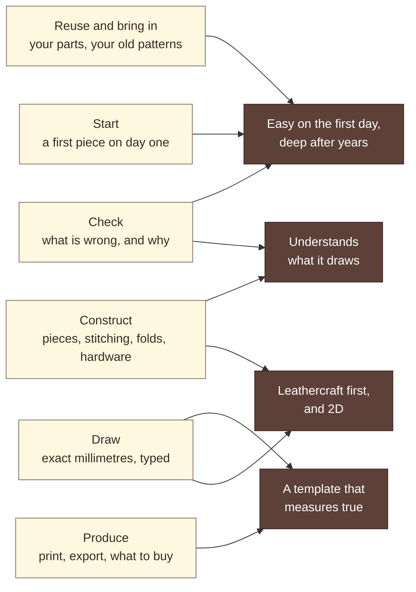
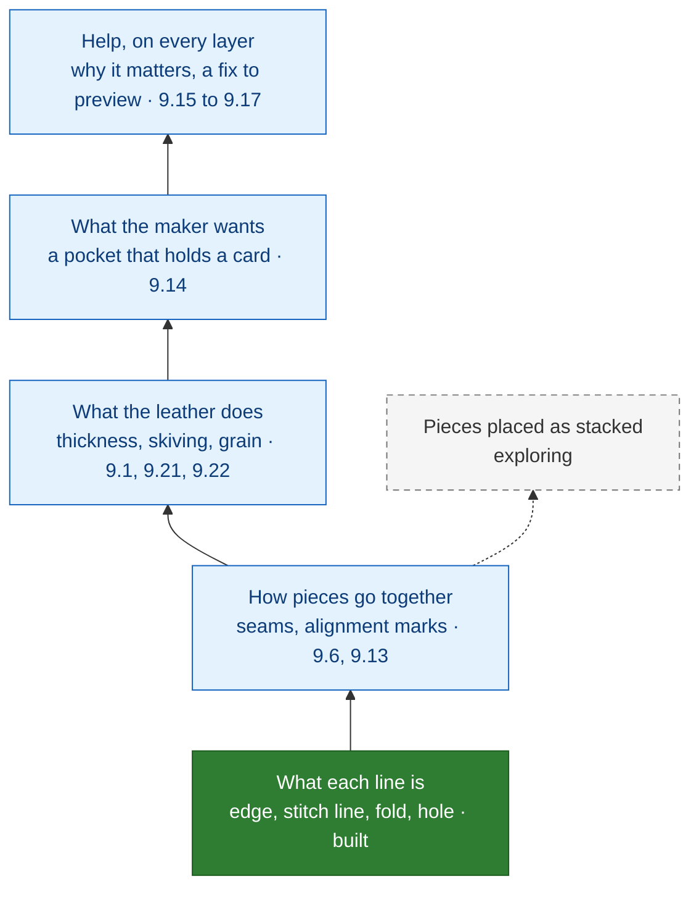
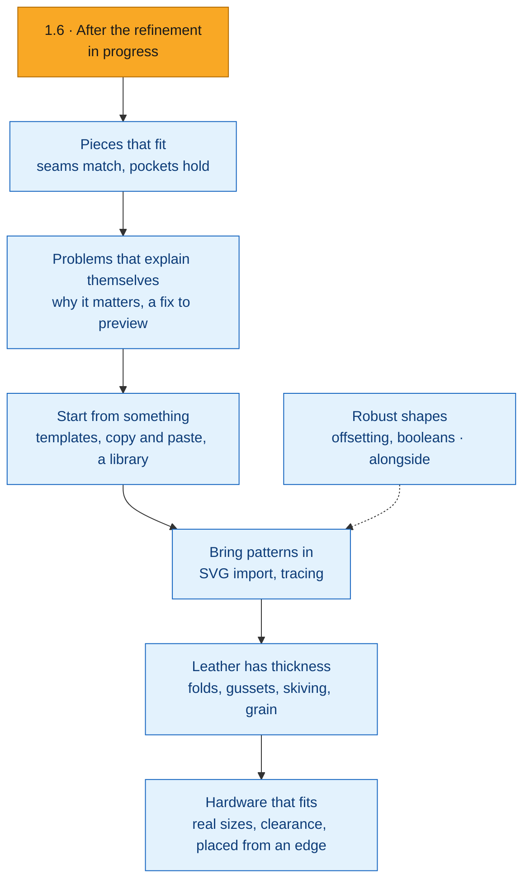
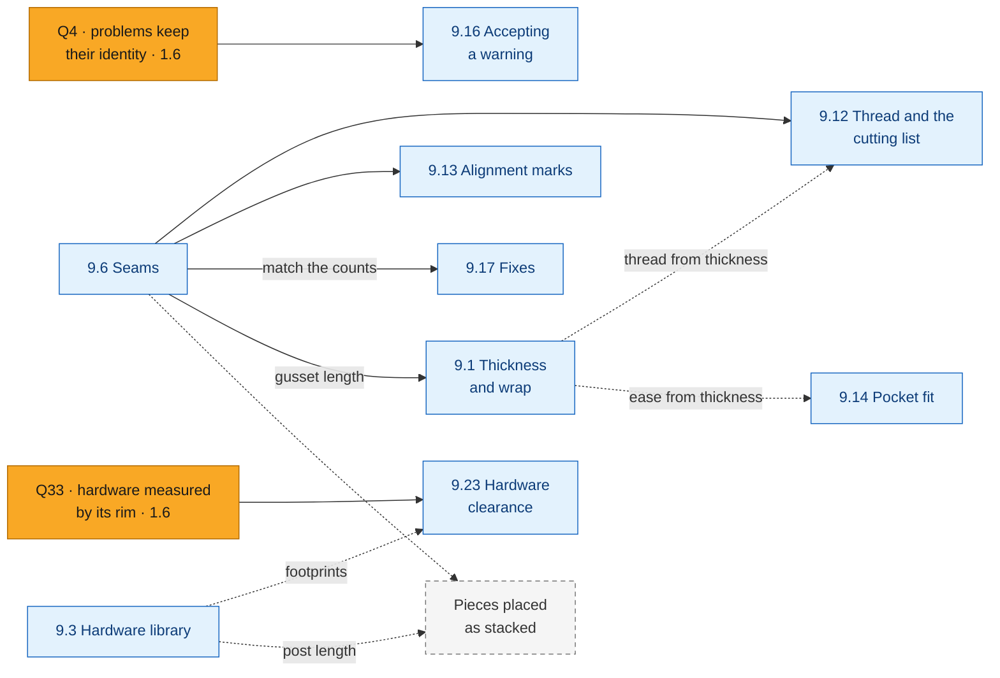
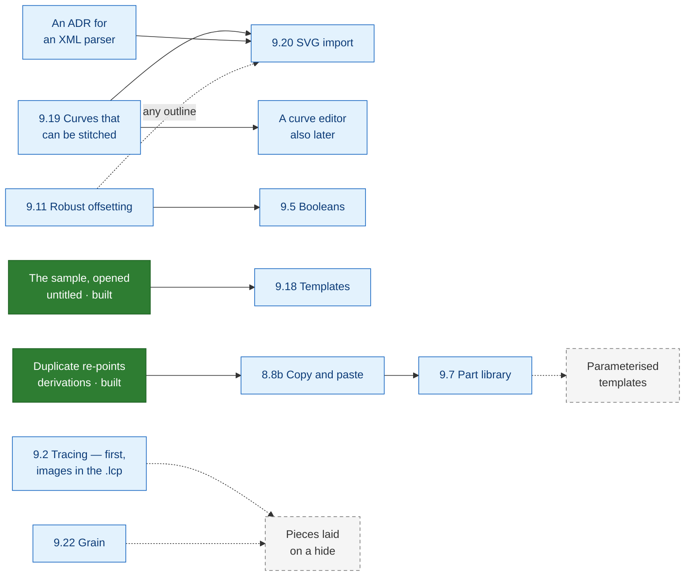

# Product roadmap

**What this is:** where LeatherCAD is going, in what order, and what each step depends on — drawn.
What LeatherCAD is and is not is [`product-spec.md`](product-spec.md); each item's scope, status and
slices are [`roadmap.md`](roadmap.md). This page owns neither: it owns the direction.
**Released:** v1.5.0 · **In progress:** 1.6 · **Last updated:** 2026-10-18

---

## 1. Where this is going

**LeatherCAD should become the tool a leatherworker reaches for to design anything made of
leather.** It is 2D, exact to the millimetre, and it knows what every line is — an edge to cut, a
seam to stitch, a fold, a rivet. Someone who has never used design software makes a stitched,
printable piece on the first day; a maker who has used it for years keeps finding a faster way.

What it is for, in the order a maker meets each problem:

| The maker's problem | Today | Where it is going |
|---|---|---|
| **Starting** — a blank page is the hardest part | A blank project, or the worked sample wallet | Start from a template; reuse your own good parts |
| **Drawing exactly** — real millimetres, typed | Lines, arcs, rectangles, circles, points; sizes typed on the board | Curves that can still be stitched; guides |
| **Knowing it will go together** — before the leather is cut | Each piece checked on its own | Pieces checked against each other, and against what they must hold |
| **Understanding what is wrong** | Every problem listed, named and shown | Each says why it matters, and offers a fix to preview and undo |
| **Making it** — a template that measures true | 1:1 PDF, printing, SVG and DXF | Calibration; the thread and leather a project takes |

The third and fourth rows are the difference between LeatherCAD and a drawing program: a pattern
that understands its own construction (§4). It grows in layers, each made of rules a maker can read
and that give the same answer every time — never a black box, never a change the maker did not
choose. The boundaries — no 3D, no general CAD or illustration, no constraint solver, no cloud —
are [`product-spec.md`](product-spec.md) §2's.

## 2. Status legend

| Status | Means | Written in |
|---|---|---|
| **Built** | Released, or merged and checked | [`CHANGELOG.md`](../CHANGELOG.md), [`history/`](history/) |
| **In progress** | The release being built: 1.6 | [`roadmap.md`](roadmap.md), *the next release* |
| **Committed** | The release after it, once one is named | [`roadmap.md`](roadmap.md) |
| **Candidate** | A milestone in *Later*, with a theme and a place in the order. Not a promise: it becomes a release only when it is next | [`roadmap.md`](roadmap.md#later) |
| **Exploring** | Worth thinking about; neither planned nor rejected | [`roadmap.md`](roadmap.md#exploring--neither-planned-nor-rejected) |
| **Not planned** | Decided against, with a reason | [`roadmap.md`](roadmap.md#not-planned), [`product-spec.md`](product-spec.md) §2 |

Colour is never the only sign: a box that is not a candidate says *built*, *in progress*, *exploring*
or its release, an exploring box has a dashed outline too, and the roadmap says the same in words.

## 3. The product map

The areas of the product, on the left, and what each one serves in the north star, on the right.
The map's colours are not statuses: what each area has and gets next is in the table below it.

| Area | What it gives the maker | The next step |
|---|---|---|
| **Start** | A first stitched piece in the first session, without a wizard: the empty panels say what to do, and the sample shows a finished wallet | Worked projects to start from (9.18) |
| **Draw** | Exact geometry, typed — sizes on the board, sums and units in any field | Guides and drafting dimensions (1.6); curves that can be stitched (9.19) |
| **Construct** | Lines that know what they are: stitching follows its edge, holes follow the iron, a mirror follows its original | Seams between pieces (9.6); thickness, skiving and grain |
| **Check** | One list of what is wrong, reachable from the board, Print and the export | Problems explained, accepted, fixed; requirements a pocket must meet |
| **Produce** | A template that measures true, printed from the app or exported | Calibration (1.6); a cutting and stitching list (9.12) |
| **Reuse and bring in** | A file that opens the same on any machine | Copy and paste, a part library, SVG import, tracing |
| **Underneath all of it** | 1:1 measured on paper (Linux; the other platforms are R8), files that always open, nothing sent anywhere, every word translatable | Update discovery (1.6), the first network request, in an ADR |

## 4. How LeatherCAD learns about leather

The differentiator is built in layers. Each layer is something the model knows, and each makes new
checks possible; help sits on top of all of them.

Not every question can be answered from a flat outline, however clever the rule. What each one
needs:

| The maker asks | From the outline alone? | What else it needs | Where |
|---|---|---|---|
| Are the stitch holes too close to an edge? | Yes — built (`HOLE_TOO_CLOSE_TO_EDGE`) | — | Built |
| Does a hardware hole clear the edge, the stitching, a fold? | Yes, measured by the hole's rim — today by its centre | Nothing new | Q33 (1.6), 9.23 |
| Do two mating seams have the same holes, lined up? | No: nothing says which edges are sewn together | A seam | 9.6, 9.13 |
| Will a card go in this pocket? | Partly: the clear size inside the stitching is geometry | What it must hold; ease, which grows with thickness | 9.14, then 9.1 |
| Will these banknotes go in? | As the card, with the note's size typed | The same | 9.14 |
| Does a snap's cap clear the stitching? | No: the cap is wider than its hole | The hardware's real size | 9.3, 9.23 |
| Is a post long enough for its layers? | No | The layers it passes through, and their thickness | *Exploring* |
| Does a gusset run the length of the panel it wraps? | The lengths, once the edges are paired | A seam; then the correction for thickness | 9.6, 9.1 |
| Does the design still do its job after a change? | Yes, once stated: every rule runs on every change, and nothing it finds is stored | Requirements; a way to accept a warning that is meant | 9.14, 9.16 |
| Is the printed text big enough to read? | Yes | Nothing new | Q34 |

## 5. The road

No dates and no version numbers beyond 1.6: a candidate gets its number when it becomes the next
release. Each milestone's items, needs, *Done when* and *Not in it* are in
[`roadmap.md`](roadmap.md#later); the table says what each is for.

| Milestone | For the maker | Main items | Needs first |
|---|---|---|---|
| [1.6 — After the refinement](roadmap.md#16--the-next-release) · *in progress* | What 1.x left: update discovery, guides, drafting dimensions, Windows printing, calibration, taped pieces finished; problems keep their identity | 8.9, 3.10, 4.10b, 7.6c, 7.5, 7.2, Q4, Q33 | — |
| [Pieces that fit](roadmap.md#pieces-that-fit) | Mating seams have the same holes, lined up; a pocket says whether the card goes in; the thread and leather are known before buying | 9.6, 9.12, 9.13, 9.14 | Nothing unbuilt |
| [Problems that explain themselves](roadmap.md#problems-that-explain-themselves) | Every problem says why it matters; a warning that is meant can be accepted; a safe fix is one click, previewed and undoable | 9.15, Q34, 9.16, 9.17 | Q4; seams for the fix most worth having |
| [Start from something](roadmap.md#start-from-something) | A new project starts from a worked one; good parts travel between projects | 9.18, 8.8b, 9.7 | Built mechanisms (8.3, 4.3b) |
| [Bring patterns in](roadmap.md#bring-patterns-in) | An Inkscape or Illustrator pattern comes in at the right size; a scan sits under the board at true scale | 9.19, 9.20, 9.2 | 9.19; an ADR for the parser; images in the `.lcp` |
| [Leather has thickness](roadmap.md#leather-has-thickness) | A fold or a gusset gets the length its leather needs; skiving and grain print | 9.1, 9.21, 9.22 | Seams; where thickness lives |
| [Hardware that fits](roadmap.md#hardware-that-fits) | Hardware placed at its real size, from an edge, and checked against everything near it | 9.23, 9.3, 9.24 | Q33 |
| [Robust shapes](roadmap.md#robust-shapes) · *alongside* | Any outline can be stitched, a thumb scoop included; shapes added and cut from each other | 9.11, 9.5 | Nothing — pure geometry |

**Why this order.** *Pieces that fit* comes first because a hole-count mismatch is the most
expensive mistake software can catch and nothing it needs is missing — the 1.0 audit called it "the
one physically important check still missing". *Problems that explain themselves* follows, so that
seam mismatches arrive with a fix. Templates come third: they need nothing and could go first if the
first day weighs more than the first cut (§7). Import waits for curves that can be stitched; thickness
waits for seams, because a gusset is a seam; hardware sizes wait for the clearance rules that use
them.

## 6. What depends on what

Two small maps, because they answer two questions. First: what the checks are built on.

- **Seams are the hinge.** Thread per seam, alignment marks, the fix that matches counts and a
  gusset's length all read a seam; nothing else unlocks as much.
- **Q4 before acceptance.** A warning the maker accepted has to find its problem again after an
  edit, and problems have no stable identity yet.
- **Q33 before hardware rules.** Every clearance rule starts from the rim; today's rules read the
  centre.
- A dotted line is a refinement, not a block: thread can be estimated before thickness is known, and
  pocket fit works with an ease the maker types.

Second: what drawing, importing and reusing are built on.

- **A curve that cannot be stitched is not much use in a leather pattern.** Analytic offsetting
  refuses cubics ([`geometry.md`](geometry.md) §6.2), and both SVG import and a curve editor bring
  them — so 9.19 comes before either.
- **A new dependency is a decision.** SVG import needs an XML parser, and every new dependency needs
  an ADR first.
- **Tracing is a format change.** The `.lcp` reserves `assets/` for images
  ([`file-format.md`](file-format.md) §1), and nothing writes it yet.
- **Reuse grows from what exists.** The sample already opens untitled, and duplicating a piece
  already re-points its derivations; templates and copy and paste extend both.

## 7. Decisions this direction needs

Each has a recommended answer, which the work takes unless the maintainer decides otherwise.

| # | Question | Recommended |
|---|---|---|
| 1 | The order of the candidate milestones | As drawn: seams and checks before templates, because they catch the mistakes that cost leather. 9.18 needs nothing, and could go first if the first day matters more |
| 2 | Nesting (9.9) moved to *Not planned* | Confirm. The question makers ask of it, how much leather a project takes, is 9.12's |
| 3 | The constraint solver (9.10) moved to *Exploring* | Confirm. It was already conditional on evidence |
| 4 | Q33 added to 1.6 | Confirm. A shipped rule misses a hole that breaks the edge: pattern correctness, the scope rule's own words |
| 5 | Does a seam change the format version? | Not alone: it changes nothing drawn, cut or printed ([`file-format.md`](file-format.md) §4.5, rule 3). The slice that prints alignment marks bumps it (rule 2) |
| 6 | Where a requirement attaches, and its ease | To the open stitch line that forms the pocket. The ease is the maker's, not set until they set it, as with thickness (U.13) |
| 7 | Where a fix is proposed | In `document`, as an ordinary command made from a diagnostic. The domain keeps reporting facts, and the app words the offer (ADR 0018) |
| 8 | The thread formula | From the spacing and the seam's thickness where both are known; otherwise 4× the seam, said to be an estimate |
| 9 | Where thickness lives | Decided in 9.1's first slice; a fold holds it today |

## 8. Evidence, and its limits

This direction rests on the repository — the 1.0 audit, the roadmap's findings, the domain model,
the code — and on how leather goods are made. Evidence from makers outside the project is thin: the
issue tracker holds no request from one yet, and the one outside contribution is a translation. The
app sends nothing home, by design ([`SECURITY.md`](../SECURITY.md)), so what makers need arrives only
when they say it. The order of the candidates is therefore a judgement to revisit: each milestone's
first slice should be one a maker can try and report on. The audit behind this page, with the state
of every idea and each discrepancy found, is
[the 2026-10-17 record](superpowers/specs/2026-10-17-product-direction-audit.md).

## 9. Where to read more

| To find | Read |
|---|---|
| What LeatherCAD is, its principles and its boundaries | [`product-spec.md`](product-spec.md) — §2 the boundaries, §4 the principles, §9 the direction |
| Each item: scope, status, release, verification | [`roadmap.md`](roadmap.md) |
| The model, seams, diagnostics and the model's open decisions | [`domain-model.md`](domain-model.md) — §7, §8, §11 |
| The layers, and where a new package goes | [`architecture.md`](architecture.md) |
| Offsetting, curves and booleans | [`geometry.md`](geometry.md) |
| Print accuracy and export formats | [`printing.md`](printing.md) |
| What a file stores, and how versions change | [`file-format.md`](file-format.md) |
| The words, from *pitch* to *alignment mark* | [`glossary.md`](glossary.md) |
| Why a decision was made | [`adr/`](adr/) — 0008 (no Clipper), 0013 (rules are reported), 0018 (words) |
| What shipped, slice by slice | [`CHANGELOG.md`](../CHANGELOG.md), [`history/`](history/) |
| How 1.0's scope was set, the precedent for this page | [the pre-1.0 product audit](superpowers/specs/2026-09-23-pre-1.0-product-audit.md) |

**How this page is kept.** It changes when a milestone's order, theme or needs change, when one
becomes the next release — its section in `roadmap.md` takes a version, and this page shows it as
committed — and when an idea moves between *Exploring*, a candidate and *Not planned*. It never
records a slice's progress: that is `roadmap.md`'s, and copying it here would only let the two
disagree.
