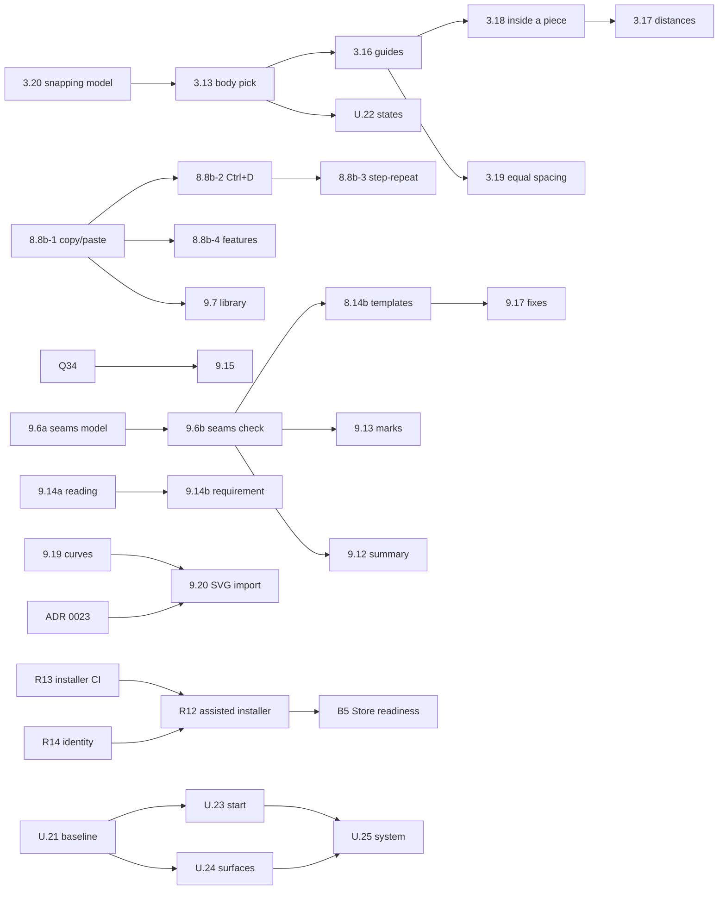

# LeatherCAD 1.7 — Design & Construct: the plan

> **For agentic workers:** one slice per session, one pull request into `develop`, never merged
> by the agent. Use the `release-1-7` agent (`.claude/agents/release-1-7.md`), or start with
> `/slice <id>`. Cite the slice id in the commit and the pull request title.

**Goal.** A maker places, copies and lines up pieces as easily as in a drawing program, at CAD
precision; the app says whether the holes on two pieces sewn together line up and whether a pocket
holds its card; patterns come in from Inkscape and Illustrator and travel between projects; the
window feels like one tool; and installing, upgrading and printing never cost the maker their
work or their scale.

**What this is.** The 1.7 scope, reviewed against the code at develop 7a69dc9 (the 1.6.0 code),
cut into vertical slices in dependency order. It started from a 41-task proposal; §4 says what
became of each task and why.

**Specs.**
[Smart guides, nudging and exact placement](../specs/2026-11-03-smart-guides-design.md) ·
[Seams, pockets and the production summary](../specs/2026-11-03-seams-and-manufacturing-design.md) ·
[Installing on Windows](../specs/2026-11-03-windows-installer-and-distribution-design.md) ·
[The 1.7 UX audit](../specs/2026-11-03-1.7-ux-audit.md).

**Roadmap:** [`docs/roadmap.md` § 1.7 — the next release](../../roadmap.md#17--the-next-release),
one line per slice, pointing here. **Direction:** [`product-roadmap.md`](../../product-roadmap.md).

---

## 0. Order of work

Six stages. They overlap: a stage starts when what it needs has merged, not when the stage before
it has finished. Within a lane, slices run one after another; lanes touch different files and can
run as separate sessions at once.

| Stage | Slices, in order | Lane |
|---|---|---|
| **1 · Foundation** | R11 (paper, maintainer) · PERF-018 · U.21 · R13 · Q41 | P, U, W, E |
| **2 · Core editor** | 3.20 → 3.13 → 3.14 → 3.15 → 3.16 → 3.18 → 3.17 → 3.19 · U.22 beside 3.13 · 8.8b-1 → 8.8b-2 → 8.8b-3 → 8.8b-4 | E (editor), R (reuse) |
| **3 · Leathercraft** | Q34 · 9.15 · 9.6a → 9.6b → 8.14b → 9.17 · 9.14a → 9.14b · 9.12 · 9.16 · 9.13 · Q21 · Q43 | D (domain) |
| **4 · Geometry and interop** | 9.19 → ADR 0023 → 9.20a → 9.20b → 9.20c · 9.7 after 8.8b · 9.11 conditional | G (geometry), R |
| **5 · UX and distribution** | U.23 · U.24a–h with or after their features · U.25 · U.26 · R14 → R12 · B5 · 7.6c conditional | U, W |
| **6 · Qualification** | R15 (grows with each slice) · R16 · R17 · R18 · the release candidate (CI/CD plan A9) | all |

**Start at once, in parallel:** R11 (the maintainer's printer), PERF-018, U.21, R13, Q41, 3.20,
Q34, 9.19. None of them waits on anything.

**The critical path** is the leathercraft lane: 9.6a → 9.6b → 8.14b → 9.17 → 9.13. Seams are the
hinge — the fix that matches counts, the marks, the thread per seam and the template fixes all read
a seam — so 9.6a starts as soon as Q34 frees the domain lane, and nothing else in that lane jumps
it.

**Files several lanes share:** `App.tsx`, `PropertyPanel.tsx`, `keymap.ts`, `en.json`,
`docs/roadmap.md`. Rebase before merging and keep each hunk to its own section. Two writers never
work on the same slice's files at once.

**Merging.** An agent opens a pull request into `develop` and stops. `develop` goes to `main` only
when every line of the roadmap's 1.7 section is ✅ (the *Release gate*). A conditional item whose
condition is not met by the release candidate moves to *Later* in a change of its own.

## 1. How every slice is done

The project's loop (`CONTRIBUTING.md` § *A change is a vertical slice*, the `vertical-slice`
skill), with what this release leans on hardest.

1. **Look before changing.** Answer the slice's *Find out first* list from the running app and the
   code, and put the answers in the pull request. Several items exist because reading the code
   turned up something that looked wrong: settle each with evidence. Seeing the app:
   [the screen-capture recipe](#looking-at-the-app) below.
2. **Trace the real flow.** Grep every caller of what you change; fix where they all route through.
3. **Test first in the pure layers** (`docs/geometry.md` §12, `docs/testing.md` §3): the property
   before the function, then the edge-case corpus. A command gets its tests before a component uses
   it. A tool is tested with synthetic events (`docs/testing.md` §5.3).
4. **Build the smallest change** that meets *Done when*.
5. **Look again**, the same screens, and adjust until it reads as the spec says.
6. **Prove print did not move** — unless the slice is about print. Export tests, golden files and
   `.lcp` fixtures pass unchanged; quote the output. A slice that changes paper says so in its
   title and adds a row to the print-verification log's procedure.
7. **Run everything:** `pnpm check`; `pnpm test:e2e` when the app changed; `pnpm build && pnpm
   test:visual --update-snapshots` when the board or the chrome changed, then look at **every**
   changed image before committing it; `/geo-check` and `/arch-check` for the pure layers.
8. **Say what was not verified**, by platform. A Windows or macOS behaviour is verified only where
   it ran (`.claude/rules/desktop-main.md`).

**Fix what you find on the way.** A bug or a plain gap inside the area being worked on is fixed in
the same pull request, with a test. A product or semantic decision is raised, not made.

**When something looks wrong, debug it** (`superpowers:systematic-debugging`): reproduce, find the
cause, then fix. A flaky test is a bug in the test or the code; it is never retried into green.

### Looking at the app

Drive the built app (`pnpm build`, then `apps/desktop/out`) with Playwright's `_electron` from a
scratch script, with its own `XDG_CONFIG_HOME` and `XDG_STATE_HOME`, `LEATHERCAD_RELEASES_URL`
pointed at nothing, and `--disable-renderer-backgrounding --disable-backgrounding-occluded-windows`.
On a Wayland desktop `page.screenshot()` can time out; capture through the main process with
`webContents.capturePage()`. A fixture path after `.` opens it. **Never press Print** in such a
script: the preview lists the real printers.

## 2. Global constraints

Everything in `CLAUDE.md` and `.claude/rules/`, and for this release in particular:

- **Millimetres, exactly.** No silent scaling, no approximation without a stated, tested tolerance
  from `core/epsilon.ts`. User input quantised (invariant 8). 1:1 printing untouched except by the
  slices that say they change paper (9.13, Q21), and those are measured on paper (R11's method).
- **Formats.** File-format §4.5 decides every version: a change to what is drawn, cut or printed
  bumps `formatVersion` (rule 2); metadata keeps it (rule 3). This release plans **two** bumps —
  format 13 with 9.13's marks and 14 with Q21's mirrored pair, in the order they merge — and none
  for seams, accepted warnings, pocket requirements, copy and paste, the library or import (§3,
  D2). Each bump: an identity migration, `fixtures/format/v<n>.lcp`, the whole corpus opening, and
  no edit to a shipped migration (invariant 9; CI fails one, D12).
- **Preserve unknown data** through every new command (§4.3). A new command copies what it changes
  and keeps what it does not.
- **Performance.** PERF-001 to PERF-017's guards stay green. A pointer move never re-evaluates the
  document; targets and candidates are collected once per gesture. Each slice that adds work on a
  hot path adds a deterministic work bound to `pnpm check` and a benchmark case
  (`.claude/rules/performance.md`).
- **Security.** An imported SVG and a pasted piece are untrusted input, validated once at the
  boundary (`.claude/rules/engineering-practices.md`, strict). No new network access. No new
  dependency without an ADR. Electron's fuses, CSP and `app://` origin unchanged.
- **Words.** Every word on screen in `en.json` through `t()`; facts below `apps/desktop`, never
  sentences (ADR 0018). A new problem code arrives with its explanation (9.15's test enforces it
  from the moment it lands).
- **UX.** A beginner succeeds without a shortcut; an expert has the exact, keyboard way. A preview
  never touches history. A destructive action is undoable or asked first. Visual feedback shows the
  domain's own answer, never a second calculation.
- **Tests.** Each slice lists its unit, property, integration, E2E, accessibility, pixel,
  performance, platform and paper checks. Nothing is claimed that did not run.
- **No private data** in commits, pull requests, docs, fixtures or screenshots.
- **Never add a ☐ or ◐ line** outside the roadmap's 1.7 section, and tick a slice's line in the
  pull request that finishes it.

## 3. Decisions

Each is taken unless the maintainer decides otherwise. **The maintainer approved D2, D4, D5, D6
and D16 on 2026-11-03, and left D11 open.** An open decision is settled before the slice that
needs it starts.

| # | Decision | Recommended | Trade-off | |
|---|---|---|---|---|
| D1 | Where a partial seam lives | On the seam relationship (`SeamSide.stretch`), not as a new `Run` arm | A second "part of a line" type; but `Run` stays what every derivation reads | Taken |
| D2 | Seams and the format version | Keep 12 (rule 3), and load and report a seam whose hole set has gone (`SEAM_SIDE_MISSING`) | A 1.6 maker sees no seam checks — acceptable, they are advisory | Approved 2026-11-03 |
| D3 | How holes are compared | Walked from the first hole of each stretch, by distance along the line | Ignores where pieces sit on the board, deliberately: the board does not stack them | Taken |
| D4 | The drift limit | 0.5 mm, a domain constant | 0.5 flags the card holder's sides (0.61 mm), passes its bottom (0.43 mm); 0.25 flags both | Approved 2026-11-03 |
| D5 | The part library | Not a new `.lcpart` store: *Save piece as template* and *Insert piece from…* a template or an open project, through 8.8b's paste | `.lcpart` stays reserved in file-format §8; one system for makers to learn | Approved 2026-11-03 |
| D6 | SVG parsing | The platform's `DOMParser` in the renderer, handing a plain tree to a headless `packages/import`; no XML dependency. ADR 0023 records the trust boundary | Parsing is tested in the app (E2E) rather than in node; the converter is pure and fully unit-tested | Approved 2026-11-03; ADR 0023 records it |
| D7 | Stitching along curves (9.19) | Fit arcs to each cubic within the flattening tolerance, for the offset only; the outline stays exact | The stitch line is within 0.005 mm of the true offset, said in geometry §6.2 | Taken |
| D8 | Concave offsetting (9.11) | Conditional; not needed for 9.19 or 9.20, which refuse what Tier 1 cannot do, by name | A thumb-scoop stitched across its corners stays refused until it lands | Taken |
| D9 | Nudge undo | One press, or one held key, is one step (begin on keydown, commit on keyup); no timer | Several separate presses are several steps | Taken |
| D10 | Select at open | An opened project starts in Select; a new blank one in Rectangle; switching tabs keeps the tool | — | Taken |
| D11 | A light shell theme | **Open.** The window is one design today, a dark shell round a light board (2026-09-17 audit §5.4). Whether 1.7 adds a light shell is decided during the release, by how the work is going. Until then U.25 keeps the one design coherent and every colour in the theme's tokens, so a second set stays possible | A light shell means every token defined twice, contrast audited twice and the pixel baselines doubled; if it is taken, it becomes a U.27 slice after U.25, added to the roadmap in a change of its own | **Open** (2026-11-03) |
| D12 | Installer data rule | No uninstaller ever removes `%APPDATA%\leathercad`; no "remove my data" option | A maker who wants a clean slate deletes one folder by hand, as `getting-started` says | Taken |
| D13 | The branch `origin/feat/windows-builder` | Reuse its *one install per account* guard and its two fixes; drop its licence page, options page, data checkbox and folder move | Fewer choices on the installer's pages, far less untested NSIS | Taken |
| D14 | Thread estimate | 4 × the stitch length, per seam when sewn (both hole sets once), rounded up to 10 cm, labelled *about* | Coarse; thickness-based once 9.1 knows thickness | Taken |
| D15 | Pocket depth | Reported, not judged, unless the requirement says *Holds it fully* | Card holders let the card stand proud on purpose | Taken |
| D16 | Store data | The MSIX package does not virtualize `%APPDATA%\leathercad` (restricted capability `unvirtualizedResources`, justified in certification) | The Store may ask why; without it, templates die with the package | Approved 2026-11-03 |

## 4. The 41 tasks, and what became of each

**Category, priority:** P0 essential · P1 in the expanded plan · C conditional. **Size:** XS < a
day · S a day or two · M a few days · L a week or more of focused slices. **Risk** is of a wrong
result or a regression, not of effort.

### A — Foundations

| # | ID | Title | Pri | For the maker | Needs | Size | Risk | Done when | Verified by |
|---|---|---|---|---|---|---|---|---|---|
| 1 | — | The 1.7 roadmap | P0 | Knows what is coming | — | — | — | This plan, the specs, the roadmap and product roadmap agree; 9.18 retired | Review of this change |
| 2 | **R11** | 1.6's printing, measured on paper | P0 | Trusts arrowheads, rows, tiles and calibration | — | S | Low | Exact readings for every new check, Linux | **Paper** |
| 3 | **U.21** | The UX baseline | P0 | — | — | M | Low | The audit register complete (every screen in its table inspected) | Screens, register |
| 4 | **PERF-018** | Packaged baselines and 1.7 workloads | P0 | 1.7 is no slower | — | M | Low | Startup, idle, RSS, soak on the packaged app recorded; new workloads in `tools/` | Measurements |

### B — Core editing

| # | ID | Title | Pri | For the maker | Needs | Size | Risk | Done when | Verified by |
|---|---|---|---|---|---|---|---|---|---|
| 5 | **Q41** | Opened projects start in Select | P0 | The first click selects | — | XS | Low | Every opening route starts in Select; blank in Rectangle | E2E per route |
| 6 | **3.13** | Pick a piece by its body | P0 | Grabs what they see | 3.20 | S | Med | Fill selects the piece; lines still win; hover shows what a click takes | Property, E2E |
| 7 | **3.14** | Select all, and nudge | P0 | Moves by keyboard | — | S | Low | Arrows 1/10/0.1 mm, rebindable; one step per press; Ctrl+A | Tool tests, E2E, axe |
| 8 | **3.15** | Typed position and Move by | P0 | Exact placement without arithmetic | — | S | Low | X/Y and Δx/Δy with sums and units, one step | Command tests, E2E |
| 9 | **8.8b** | Copy, paste, duplicate (4 slices) | P0 (1–2), P1 (3–4) | Reuses pieces across projects | — | M | Med | Whole pieces across tabs, re-pointed, never dangling; Ctrl+D; step-and-repeat; features safely | Property, E2E |
| 10 | **U.22** | Selection, hover and locked states | P1 | Sees what a click will do | 3.13 | S | Low | Hover, selected, editing and locked distinct on board and in Parts | Pixels, axe |

### C — Smart precision

| # | ID | Title | Pri | For the maker | Needs | Size | Risk | Done when | Verified by |
|---|---|---|---|---|---|---|---|---|---|
| 15 | **3.20** | One snapping model | **P0** (was P1) | Snaps that do not jitter | — | M | Med | One priority table; hysteresis; candidates with sources; behaviour unchanged otherwise | Property, bench |
| 11 | **3.16** | Smart guides while moving | P0 | Lines pieces up exactly | 3.20, 3.13 | L | Med | Edge and centre alignment to pieces and guides, exact to the quantum | Property, E2E, pixels, bench |
| 12 | **3.18** | Placing inside a piece | P0 | Centres a snap on a flap | 3.16 | M | Med | Host piece's centre and edges first; rotated and irregular rules | Property, E2E |
| 13 | **3.17** | Live distances and clearance | P0 | Sees 1.5 mm before punching | 3.16 | M | Low | Δ readout; edge distances to the real outline; rim clearance = the rule's | Property (⇔ rule), E2E |
| 14 | **3.19** | Equal spacing | P1 | Card slots evenly apart | 3.16 | S | Low | Equal gaps snapped and labelled; never on turned or irregular extents | Property, E2E |

Task 15 moved ahead of task 11 and became P0: smart guides add candidates to a snapping model that
today has a priority list but no axis candidates, no hysteresis and no record of where a candidate
came from. Building guides first and unifying after would be built twice.

### D — Leathercraft intelligence

| # | ID | Title | Pri | For the maker | Needs | Size | Risk | Done when | Verified by |
|---|---|---|---|---|---|---|---|---|---|
| 22 | **Q34** | Printed text too small | P0 | A legible template | — | XS | Low | `TEXT_TOO_SMALL_TO_PRINT` under 1.5 mm | Property |
| 22 | **9.15** | Every problem explained | P0 | Knows why and what to do | Q34 | S | Low | Every listed code has *why* and *what to do*; audit test; next/previous problem | Audit test, E2E |
| 16 | **9.6a** | Seams, modelled | P0 | — | Q4 (built) | L | High | Seam model, schema, stretches, `alongMm`, deletion, dangling seams | Property, corpus |
| 17 | **9.6b** | Seams, checked and made | P0 | Holes that line up | 9.6a | L | High | DR7 codes; *Sew together*; selection bar line; Problems names both | Property, E2E |
| 18 | **8.14b** | Built-in templates, checked as leatherwork | P0 | Templates worth copying | 9.6b | S | Med | Every template derived where it should be, seams declared and clean, maker's questions answered | Evaluator tests, E2E, paper |
| 23 | **9.17** | Safe fixes | P1 | One click to a seam that matches | 9.6b | M | Med | Previewed fix, one step, refused when stale | Property, E2E |
| 23 | **9.16** | Accepting a warning | P1 | Stops re-reading a warning they weighed | Q4 | S | Low | Accepted until its cause changes; never an error | Property, corpus |
| 20 | **9.14a** | A pocket's clear size | P1 | Sees the room inside | — | S | Low | Clear width and depth of an open stitch line | Property |
| 20 | **9.14b** | A pocket that holds what it must | P1 | Card fits before cutting | 9.14a | S | Med | Requirement, ease, `POCKET_TOO_NARROW` / `_SHALLOW` | Property, E2E |
| 21 | **9.12** | Production summary | P1 | Knows what to cut and buy | 9.6b | S | Low | Pieces, holes, hardware, thread, net leather; estimates labelled | Property, E2E |
| 19 | **9.13** | Alignment marks | P1 | Pieces line up at the bench | 9.6b | M | Med | Marks at paired holes on both pieces; format 13 | Property, **paper** |
| 24 | **Q21** | Cut two, one turned over | P1 | Never cuts two lefts | — | S | Med | *Cut as a mirrored pair*; caption on paper; format 14 | Property, **paper** |
| — | **Q43** | A laser export warns about overlapping pieces | P1 (new) | Pieces placed on top of each other are not cut through each other | — | XS | Low | The export dialog names overlapping pieces for *Laser cut* | Property, E2E |

### E — Reuse and interoperability

| # | ID | Title | Pri | For the maker | Needs | Size | Risk | Done when | Verified by |
|---|---|---|---|---|---|---|---|---|---|
| 25 | **9.7** | The part library, through templates | P1 | Their good parts in every project | 8.8b-2 | M | Med | *Save piece as template*, *Insert piece from…*; one system | Property, E2E |
| 26 | **9.19** | Stitching along curves | P1 | A curved edge stitched | — | L | **High** | Arc-fitted offsets within 0.005 mm; refusals by name | Property, golden |
| 27 | **9.20** | SVG import (3 slices) | P1 | Their Inkscape patterns, at size | 9.19, ADR 0023 | L | High | Units read and confirmed; preview; roles; omissions listed; untrusted input safe | Unit, E2E, security |
| 28 | **9.11** | Robust concave offsetting | C | Stitching across a thumb scoop | — | L | High | geometry §6.3's rules | Property |

**9.11's condition:** R16 shows a template or a maker's pattern that needs stitching across a
concave join, and the slice is started with geometry §6.3 in hand. Otherwise it stays in *Later*
(moved out at the release candidate).

### F — The interface

| # | ID | Title | Pri | For the maker | Needs | Size | Risk | Done when | Verified by |
|---|---|---|---|---|---|---|---|---|---|
| 29 | **U.23** | Start screen | P0 | Starts from a template in one click | U.21 | S | Low | Template cards, a primary action, recent work | Pixels, axe, E2E |
| 30 | **U.24a–h** | The 1.6 surfaces, refined | P0 | One coherent tool | U.21 | M (8 S) | Low | Each register finding closed | Pixels, axe, E2E |
| 31 | **U.25** | The visual system and accessibility | P0 | Polished, readable, keyboard-usable | U.24 | M | Low | Tokens, states, focus, contrast, minimum window, HiDPI | Axe, pixels, by hand |
| 32 | **U.26** | Languages, ready | P1 | A translation that fits | — | S | Low | Production en/pl/de/ru/fr; safe English fallback; non-blocking coverage; overflow checks; #87 credited | Locale tests |

### G — Installation and distribution

| # | ID | Title | Pri | For the maker | Needs | Size | Risk | Done when | Verified by |
|---|---|---|---|---|---|---|---|---|---|
| 33 | **R13** | The shipped `.exe`, installed in CI | P0 | — | — | M | Low | Install, upgrade from 1.6.0, uninstall, data intact, in CI | CI |
| 35 | **R14** | Identity and document icons | P0 | A pinned app that behaves; `.lcp` files with an icon | — | S | Low | AUMID, description, document icons on all three | Unit, **by hand** |
| 34 | **R12** | The assisted Windows installer | P0 | Chooses where and for whom, safely | R13, R14 | M | Med | Guarded folder, one install per account, data kept | CI, **by hand on Windows** |
| 36 | **B5** | Store readiness | P1 | No SmartScreen, updates by the Store | R12 | M | Med | MSIX built, data survives reinstall, steps for the maintainer | CI on Windows |
| 37 | **7.6c** | Printing from Windows | C | Print without a viewer | a Windows PC and printer | M | High | A measured row in the log | **Paper** |

### H — Qualification

| # | ID | Title | Pri | For the maker | Needs | Size | Risk | Done when | Verified by |
|---|---|---|---|---|---|---|---|---|---|
| 38 | **R15** | Pixels and axe for what 1.7 adds | P0 | — | each slice | S | Low | A baseline and a scan per new screen | CI |
| 39 | **R16** | Manufacturing workflows, end to end | P0 | — | most of 1.7 | M | Med | Card holder, bifold, multi-piece, sewn, reused, imported — E2E and paper | E2E, **paper** |
| 40 | **R17** | Full regression and packaged qualification | P0 | — | all | M | — | §7's gates, on every platform there is | CI, by hand |
| 41 | **R18** | Release documentation | P0 | Finds out what is new | all | S | Low | README media, getting-started, keys, formats, notes | Review |

**Changed or excluded, and why:**

- **Task 1** is this change, not a slice.
- **Task 15** became 3.20, P0, and comes first (above).
- **Task 22** is two slices, Q34 and 9.15: the rule and the words land and are reviewed apart.
- **Task 23** is two slices, 9.16 and 9.17, which need different things (Q4; 9.6b).
- **Task 20** is two slices: the reading needs nothing; the requirement adds metadata and words.
- **Task 30** is eight small slices, U.24a–h, one per surface, each landing with or after the
  feature that changes that surface.
- **Task 31**'s "dark and light themes": there is one theme today. Whether 1.7 adds a light shell
  is open (D11), decided by how the work is going; U.25 keeps it possible.
- **Task 9**'s single-feature copying is 8.8b-4, P1: safe because a derived feature copied without
  its source pastes as drawn geometry, said before it is pasted (the existing *freeze* semantics).
- **Added:** Q43 (a laser export of overlapping pieces cuts them through each other: smart guides
  make stacking pieces easy, and 6.4 exports the board as arranged), and 8.8b-3's
  *step-and-repeat* (Ctrl+D again repeats the last offset: card slots stepped down a panel).
- **Retired:** 9.18 (templates), shipped as 8.14 in 1.6.
- **Not added:** Space-drag panning — the middle button and Alt-drag already pan; Alt-drag
  duplication — Alt pans; alignment while drawing, inclined-edge alignment, size matching by drag
  (smart guides spec §14).

## 5. The slices

Each slice: what it is for, what the code does today, what to build, what to find out first, how
to know it is done, its tests, what to watch for, the docs it changes, and its pull request title.
*Model* is the suggested agent model and effort.

### Stage 1 — Foundation

#### R11 1.6's printing, measured on paper · S · the maintainer

**For the maker.** 1.6 changed four things that print — dimension arrowheads (4.10b), rows of holes
(4.14), taped sheets with arrows and an assembly map (7.2), and printer calibration (7.5) — and none
was measured on paper. The last physical row in the log is 2026-10-09 (1.3.5's candidate), and its
readings were "within 0.5 mm, exact readings not noted".

**Today.** `docs/print-verification-log.md` checks A–H; `e2e/print-verification.spec.ts` and the
packaged smoke test measure the PDF with poppler. `fixtures/projects/print-test.lcp` has no hole row
and no part taped into a grid.

**Build.** A second fixture, `fixtures/projects/print-test-assembly.lcp`, made with the app's
commands: a part taped across a 2 × 2 grid on A4 (it prints an assembly map), and a 4 mm hole row
25 mm apart. The procedure gains checks: **I** a hole row's diameter and its first-to-last length;
**J** a 2 × 2 taped part, assembled by its crosses and arrows, measured edge to edge; **K** the
assembly map is labelled *not to scale* and is not used for cutting; **L** calibration: print the
calibration page, enter the readings, then print the print test corrected and measure A–F; **M**
*Remove correction* prints uncorrected again. `e2e/print-verification.spec.ts` measures the new
fixture's PDF as it does the first.

**Find out first.** Whether the Brother's driverless queue applies its own correction (compare a
corrected and an uncorrected print). Whether D (arrowhead tip to tip) reads the same as the old
extension-line reading.

**Done when.** Rows in the log with **exact** readings to the half millimetre for A–M on Linux,
the printer, driver and paper named; any reading over 0.5 mm investigated and either fixed
(a 1:1 bug holds every printing slice) or explained in the row.

**Tests.** The new fixture's automated measurement in E2E; nothing else changes.

**Docs.** The log's procedure; release checklist §3 and §6.

**PR.** `test(print): measure 1.6's arrowheads, hole rows, taped grids and calibration on paper (R11)` · Sonnet, medium, plus the maintainer's hour at the printer.

#### PERF-018 Packaged baselines and the 1.7 workloads · M

**For the maker.** 1.6 made long sessions, big outlines and long PDFs fast; 1.7 adds guides,
seams, import and copying. Without a baseline on the packaged app nobody can say 1.7 kept 1.6's
speed.

**Today.** `docs/performance-backlog.md` § *Remaining profiling checklist* lists what was never
measured: packaged startup, a two-hour soak, guide and alignment workloads. `tools/perf-*.mjs`
reconstruct 1.6's workloads; `fixtures/perf/` holds the outlines and the strap.

**Build.** `tools/perf-startup.mjs` (packaged app: time to first frame and to the version showing,
cold and warm, RSS after 10 s idle, idle CPU over 60 s, frames scheduled while idle);
`tools/perf-soak.mjs` (the backlog's two-hour cycle, sampled every ten minutes). New workloads,
committed in `packages/domain/src/workloads.ts` and `fixtures/perf/`: 200 pieces on one board; a
bifold with 6 seams; an SVG of 300 paths. A 1.7 section in the backlog's measurement record with
the method, machine, build and run counts.

**Find out first.** Whether `pnpm package:dir` with the E2E fuse is close enough to the shipped
binary for startup timing (the fuse is the inspector only).

**Done when.** The numbers are in the backlog, on Linux; the tools run on Windows and macOS CI as a
manual dispatch. No budget is set from them (no tight wall-clock budget in CI); later slices compare
against them on the same machine.

**PR.** `test(perf): packaged startup, idle and soak baselines, and 1.7's workloads (PERF-018)` · Opus, medium.

#### U.21 The UX baseline · M

**For the maker.** Nothing yet — this is how 1.7's interface work knows what to fix.

**Today.** [The audit register](../specs/2026-11-03-1.7-ux-audit.md) holds what the first pass saw,
and the table of what was not inspected.

**Build.** Inspect every screen marked *not inspected* or *from code only*: Problems with errors,
the export dialogs, calibration, the recovery and unsaved dialogs, tab management, the template
management actions; a keyboard-only walk from the start screen to a printed PDF; Orca (Linux)
announcing a save, a problem and a selection; 2× display ratio, 125 % and 150 % scaling, the
minimum window; workflows: a card holder from blank, a bifold from the template, a five-piece bag.
Add each finding to the register with severity, steps, expected behaviour and its slice.

**Done when.** The register's *Not inspected* column is empty for Linux; Windows and macOS rows say
what waits for R17.

**PR.** `docs(ux): the 1.7 UX baseline, every screen inspected (U.21)` · Opus, medium.

#### R13 The shipped `.exe`, installed in CI · M

**For the maker.** Every Windows maker runs the installer; CI has never run it.

**Today.** `.github/workflows/installers.yml` builds the `.exe`; `e2e/packaged/packaged.spec.ts`
drives `win-unpacked`. The `.deb` job (*Installed smoke test*, *Uninstall*) is the model.

**Build.** [The installer spec](../specs/2026-11-03-windows-installer-and-distribution-design.md)
§5 steps 1–4 against today's one-click installer, steps 5–6 recorded as expected to fail until
R12. A small PowerShell helper in `tools/ci/` reads the registry and compares the seeded files.

**Find out first.** That `gh attestation verify` works for 1.6.0's `.exe` on a Windows runner with
the workflow's token; that a silent one-click install needs no desktop session.

**Done when.** The job passes on a pull request that touches packaging; `Ready to merge` sums it; a
deliberately broken installer (a scratch branch) fails it.

**Watch for.** `.claude/rules/workflows.md` (strict): pinned actions, least privilege,
`persist-credentials: false`, a timeout, a comment per step.

**PR.** `ci: install, upgrade and uninstall the Windows installer, keeping the maker's data (R13)` · the `ci-shipping` agent's rules, Opus, medium.

#### Q41 Opened projects start in Select · XS

**For the maker.** Open the bifold template and click a piece to look at it: today that starts a
rectangle.

**Today.** `App.tsx`: `const [toolId, setToolId] = useState<string>('rectangle')` and
`designToolRef` start every window in Rectangle; the tool is the window's, not the tab's.

**Build.** When a project opens into a tab — a file, a recent entry, a template, a launch or second
launch, a `.lcp` dropped on the window, a restored session tab, a recovery copy — the tool becomes
Select. *New project from scratch* still starts in Rectangle. Switching tabs keeps the tool (D10).

**Done when.** An E2E per route clicks a piece's line and finds it selected and no rectangle begun.

**PR.** `fix(desktop): an opened project starts with Select (Q41)` · Sonnet, medium.

### Stage 2 — The core editor

#### 3.20 One snapping model · M

**For the maker.** Snaps that hold still, the same at any zoom, and the foundation smart guides
sit on.

**Today.** `snap.ts`: `PRIORITY`, `snap()` choosing by kind then distance, `SnapCandidate` with a
point and an optional feature or guide; `tool.ts` `snapped()` applies it once per event, Ctrl
suspends.

**Build.** [Smart guides spec](../specs/2026-11-03-smart-guides-design.md) §5: a candidate with a
source and either a point or an axis value; the one priority table; hysteresis; ties by document
order; `smartGuides` preference wired but nothing new drawn yet. Point snapping's behaviour stays
the same except for the hysteresis.

**Find out first.** Whether any test or E2E depends on the jitter (a snap flipping between two
targets); measure the current per-move snap cost on `traced-1000.lcp` (PERF-018's workload).

**Done when.** Every existing snap and E2E test passes unchanged; the property tests of spec §13
for priority, ties and hysteresis pass; the benchmark is no slower.

**PR.** `refactor(editor): one snapping model, with sources, priorities and hysteresis (3.20)` · Opus, high.

#### 3.13 Pick a piece by its body · S

**Needs** 3.20 (the hover uses its candidate sources).

**For the maker.** Pieces are drawn filled (U.1); a click on the fill should take the piece.

**Today.** `hitTest` tests lines only; `selectTool.onPointerDown` starts a band when it misses.

**Build.** Spec §3: material containment with `PathOps.containsPoint` against the outer outline and
the cut-outs, exactly as DR2's `isOnMaterial` does (`validate.ts`) — reuse it rather than a second
copy; the topmost piece; select as `selectParts`; drag moves the piece whole; hover shows the piece
or the line a click will take.

**Find out first.** Every E2E that starts a band inside a piece (grep `mouse.down` in `e2e/`);
whether a box over a large piece is missed (spec §3).

**Done when.** On the bifold: a click mid-panel away from the fold selects the outer; on the fold
selects the fold; in a slot of the lining selects nothing.

**Tests.** The pick property (spec §13); tool tests; E2E; axe unaffected.

**PR.** `feat(editor): a click on a piece's body selects the piece (3.13)` · Opus, medium.

#### U.22 Selection, hover and locked states · S · beside 3.13

**For the maker.** Seeing, before clicking, what a click will take; seeing a locked piece is locked.

**Build.** One hover, selected, editing (Edit points) and locked treatment on the board and the same
words and marks in Parts, from the theme's tokens; a locked piece's hover shows the lock; the Parts
row of the hovered piece highlighted (7.4d's shared hover already exists for Sheets).

**Done when.** Each state is distinguishable without colour alone; the pixel baseline shows all four.

**PR.** `feat(desktop): hover, selected, editing and locked read differently (U.22)` · Opus, medium.

#### 3.14 Select all, and nudge · S

**Build.** Spec §4: arrows through the keymap (bindable, listed), the gesture per press (D9),
`pieceScope` and `transformRefusal` as a drag; Ctrl+A on the board selects every visible, unlocked
piece.

**Find out first.** Which elements take arrow keys today (tree, tab strip, menus, number fields,
`ViewSwitch`) and that the board's focus is distinguishable from theirs.

**Done when.** With the board focused: each modifier moves by its step; a held key is one undo step;
a locked piece says why; arrows in a field still move the caret.

**Tests.** Keymap tests; tool tests with synthetic key events; E2E; axe on the board focused.

**PR.** `feat(desktop): arrow keys nudge the selection, and Ctrl+A selects every piece (3.14)` · Sonnet, high.

#### 3.15 Typed position and Move by · S

**Build.** Spec §4's two field groups in Properties › Arrange (`ArrangePanel.tsx`), through
`NumberField` (sums, units, quantising), dispatching `translateFeatures`.

**Done when.** Typing X = 20 puts the selection's left edge at 20.0 on the ruler; Move by −12 moves
it 12 mm left; one undo step each; a locked selection shows the fields disabled with the reason.

**PR.** `feat(desktop): type where the selection is, or how far to move it (3.15)` · Sonnet, medium.

#### 3.16 Smart guides while moving · L

**Needs** 3.20, 3.13.

**Build.** Spec §6 for whole pieces: references, targets collected once from
`committedDocument`, per-axis matching with the priority table, exact replacement of the axis
delta, the overlay of spec §9.

**Find out first.** The move's delta today is snapped cursor − snapped press; decide with tests how
the press point's snap and the guides combine (spec §6 says a point snap wins both axes).

**Done when.** Dragging the card holder's pocket near the outer's left edge aligns it exactly
(Properties' X equal to the outer's); Ctrl suspends; Escape restores; one undo step.

**Tests.** Spec §13's properties; tool tests; E2E; a pixel baseline; the benchmark and work bound.

**PR.** `feat(editor): smart guides line a moved piece up with edges, centres and guides (3.16)` · Opus, high.

#### 3.18 Placing inside a piece · M

**Build.** Spec §6's host-piece targets, and its rules for turned and irregular pieces.

**Done when.** On the key fob, dragging a rivet near the strap end's centre line puts it on that
line exactly; on a turned rectangle only the centre is offered; the label says *centre of its
extent* on an irregular piece.

**PR.** `feat(editor): features moved inside a piece line up with that piece's centre and edges (3.18)` · Opus, high.

#### 3.17 Live distances and clearance · M

**Build.** Spec §7: the Δ readout; ray distances to the real outline; the rim clearance through the
same function `HOLE_TOO_CLOSE_TO_EDGE` uses — export it from `validate.ts` (today `distanceToEdge`
and `MIN_HOLE_EDGE_CLEARANCE_MM` inside `offMaterial`) rather than re-implementing it.

**Done when.** Dragging a 4 mm rivet toward the key fob's edge turns its clearance label to the
warning tone at the same position Problems starts listing it after the drop.

**Tests.** The ⇔ property; ray distances on curved outlines against `PathOps` closest points.

**PR.** `feat(editor): a move shows how far it went and how near the edges it is (3.17)` · Opus, high.

#### 3.19 Equal spacing · S

**Build.** Spec §8.

**PR.** `feat(editor): a moved piece snaps to equal gaps between its neighbours (3.19)` · Opus, medium.

#### 8.8b-1 Copy and paste whole pieces, across tabs · M

**For the maker.** Their good card slot from last month's wallet in this one, without redrawing it.

**Today.** `duplicatePart` (`packages/document/src/commands.ts`) copies a part, re-points every
reference inside it and leaves those outside; `App.tsx` `requestDuplicatePart` gives it fresh ids.
Ctrl+C/V are a text field's only (`keymap.ts`, scope `field`). All tabs live in one renderer.

**Build.** A clipboard held in the renderer, holding a validated copy of whole parts (their
`Part` JSON as stored, with the guides left out), shared by every tab. *Paste* inserts them with
fresh ids, re-pointing what is inside, and resolving what points out: a mirrored counterpart pasted
without its original becomes an independent copy of its evaluated geometry (said before pasting);
a dimension to another part is dropped and named in the notice. Placed under the pointer when it is
on the board, otherwise offset as *Duplicate* places. One undo step. The pasted copy is validated
with `persist`'s schema as any file is (trust boundary).

**Find out first.** Every kind of reference a part can make outside itself (graph.ts); what a
pasted part's `quantity`, lock and hidden state should be (keep them).

**Done when.** Copy the bifold's card pocket, paste into a new tab: it evaluates identically,
translated; its stitching follows its own outline; nothing names the other project.

**Tests.** Property: paste ∘ copy evaluates to the same geometry moved by the offset, with no id
shared with the source document and no dangling reference; E2E across two tabs; undo.

**PR.** `feat(desktop): copy whole pieces and paste them into any open project (8.8b)` · Opus, high.

#### 8.8b-2 Duplicate by key · XS

**Build.** Ctrl+D (bindable) duplicates the selected pieces, as the menu does.

**PR.** `feat(desktop): Ctrl+D duplicates the selected pieces (8.8b)` · Sonnet, medium.

#### 8.8b-3 Step and repeat · S · P1

**For the maker.** Three card slots stepped 15 mm down a panel: duplicate, move 15 mm, duplicate
again, and the third lands 15 mm further.

**Build.** Ctrl+D right after a duplicate that was then moved repeats that move on the new copy.
Remembered per tab, forgotten on any other command.

**PR.** `feat(desktop): duplicating again repeats the last move (8.8b)` · Sonnet, high.

#### 8.8b-4 Copy and paste features · M · P1

**Build.** Features pasted into the selected piece: root features as they are; derived features
with their sources when the sources come too; a derived feature without its source pastes as drawn
geometry — the existing *freeze* — and the notice says so before pasting. Refused into no piece.

**PR.** `feat(desktop): copy features into another piece, frozen when their source stays behind (8.8b)` · Opus, high.

### Stage 3 — Leathercraft intelligence

#### Q34 Printed text too small · XS

**Today.** `INVARIANTS_WITHOUT_A_CODE` in `packages/domain/src/problems/codes.ts` still says DR5 is
"Planned … in 4.11"; domain-model §8.6 gives 1.5 mm; labels have had a height since 4.11b.

**Build.** `TEXT_TOO_SMALL_TO_PRINT` (rule, DR5, warning) on a text label under 1.5 mm cap height;
the uncoded-invariant row removed; the explanation in `en.json`.

**Tests.** Property: a label at or above 1.5 mm never reports, below always does; scaling a piece
does not change it (Q31 keeps text size).

**PR.** `feat(domain): a label too small to read on paper is a warning (Q34)` · Opus, medium.

#### 9.15 Every problem explained · S

**Today.** Most listed codes already say why and what to do (`en.json` › `problems`, e.g.
`HOLE_TOO_CLOSE_TO_EDGE`, `HOLE_SPACING_DEVIATION`); *go to* exists (`ProblemList.tsx` `onGoTo`).

**Build.** Every code the drawer can list (category `outcome` or `rule`) has a `why` and a `fix`
string; an audit test fails a listed code without both. Rewrite the few that state only a fact.
F8 and Shift+F8 (bindable) go to the next and previous problem on the board.

**Done when.** The audit test is green with every code; a maker can walk all problems by keyboard.

**PR.** `feat(desktop): every problem says why it matters and what to do (9.15)` · Opus, medium.

#### 9.6a Seams, modelled · L

**Spec:** [seams](../specs/2026-11-03-seams-and-manufacturing-design.md) §2–§3, §12.

**Build.** `Seam`, `SeamSide`, stretches; `alongMm` on `StitchHole` from the distributor; the
schema (`persist`) with the optional `seams` array; structural refusals and the outcome codes;
deletion through the reference graph (ADR 0009) and the delete dialog's list; dangling seams loaded
and reported; `problemKey` with the seam id. No interface yet beyond what a test drives.

**Find out first.** That 1.6's loader preserves a project-level unknown array through open, edit
and save (a test against the released schema); every place a hole set's id is followed (graph.ts).

**Done when.** The properties of spec §12 for the model; the corpus opens; a file with seams
round-trips byte-identical; D2 approved before merge.

**PR.** `feat(domain): seams between two runs of holes, or part of one (9.6)` · Opus, high.

#### 9.6b Seams, checked and made · L

**Build.** DR7's two codes with facts and words; *Sew together…* (context menu, Properties) with
the inline panel, preview and one undo step; the selection bar's third line; Properties' list of a
hole set's seams; the board highlight while a seam is selected.

**Done when.** The card holder's three seams read as spec §5 says; Problems names both pieces and
frames both; the drift limit is D4's.

**PR.** `feat: sew two pieces together and see whether their holes line up (9.6)` · Opus, high.

#### 8.14b Built-in templates, checked as leatherwork · S

**Today.** All four templates evaluate with no problems. The card holder's pocket stitch line is
drawn, not derived, and drifts 0.61 mm from the outer; the bifold's pockets are drawn paths, 87.0 mm
between stitch lines for an 85.60 mm card, and its lining's edge would be 1 mm from the outer's
stitching; the key fob's rivets are independent (seams spec §1, §8).

**Build.** With a maker's answers to seams spec §8: stitch lines derived from outlines where the
outline is a shape; the card holder's pocket sized so its seams match (spec §5); the bifold changed
or its choices written in its description; the key fob's second rivet a fold mirror; seams
declared where both pieces have holes. Each template rebuilt with the app's own commands and
saved; `templates.test.ts` asserts every template is clean, every declared seam matches and every
stitch line that can be derived is. Fixtures that other tests read (`graph.test.ts`,
`measure.test.ts`, `e2e/tabs.spec.ts`, `e2e/recovery.spec.ts`) are checked and kept or given their
own copy.

**Done when.** Each template opens untitled, clean, its seams matching, and prints; the card holder
is cut from leather once and its holes line up (recorded as a construction check).

**PR.** `fix(templates): the card holder, bifold and key fob go together as made (8.14b)` · Opus, high, and a maker.

#### 9.17 Safe fixes · M · P1

**Build.** A fix is an ordinary command proposed from a diagnostic (product-roadmap decision 7):
first the seam's (spec §5: the length that makes both sides walk alike), the stitch margin that
clears an edge, the iron that matches the spacing. Pointing at it previews through the store's
preview; choosing it is one step; a fix that no longer applies is refused, saying why (X1).

**PR.** `feat: a problem with one plainly safe fix offers it, previewed and undoable (9.17)` · Opus, high.

#### 9.16 Accepting a warning · S · P1

**Build.** *Accept* on a warning (never an error): stored in the project as `{ problemKey }`
entries (metadata, rule 3); shown as accepted, not counted on Print; back when its key or its facts'
cause changes (the stored key no longer matches); *Un-accept*.

**PR.** `feat: a warning the maker accepts stays quiet until its cause changes (9.16)` · Opus, medium.

#### 9.14a A pocket's clear size · S · P1 · 9.14b A pocket that holds what it must · S · P1

**Build.** Seams spec §7: the reading for any open stitch line; then the requirement, the ease from
My tools when set, `POCKET_TOO_NARROW` and, when asked, `POCKET_TOO_SHALLOW` (DR8).

**Done when.** The card holder reads 99.0 × 38.0 mm; the bifold 87.0 mm across; an ID-1 card with
2 mm ease flags the bifold and not the card holder.

**PRs.** `feat: an open stitch line shows the pocket it makes (9.14)` · `feat: a pocket says whether its card goes in (9.14)` · Opus, medium.

#### 9.12 Production summary · S · P1

**Build.** Seams spec §10, in Properties with nothing selected; *Copy* as text.

**Done when.** The card holder's numbers as spec §10 gives them.

**PR.** `feat(desktop): what to cut, punch and buy, from the pattern (9.12)` · Sonnet, high.

#### 9.13 Alignment marks · M · P1 · changes paper

**Build.** Seams spec §6; format 13 with its fixture; marks on the board, the Sheets view, the PDF,
SVG and DXF (the marking layer).

**Done when.** The fixed card holder's marks measure equal along both pieces on paper (R11's
method), recorded in the log.

**PR.** `feat: marks at matching holes on both pieces of a seam, printed (9.13)` · Opus, high.

#### Q21 Cut two, one turned over · S · P1 · changes paper

**Build.** Seams spec §11; format 14 (or 13, whichever lands first); the caption on paper, Parts and
the summary.

**PR.** `feat: a piece cut as a mirrored pair says to turn the template over (Q21)` · Opus, medium.

#### Q43 A laser export warns about overlapping pieces · XS · P1

**Build.** The export dialog, for presets including the `cut` role, names pieces whose outlines
cross or contain each other (`intersectPaths`, `containsPoint`), with *Export anyway*. The domain
reports facts; the dialog words them. Not a domain rule: overlapping is fine on paper.

**PR.** `feat(export): a laser cut names pieces that overlap on the board (Q43)` · Sonnet, high.

### Stage 4 — Geometry and interoperability

#### 9.19 Stitching along curves · L · high risk

**Today.** Tier 1 offsetting (`packages/geometry/src/ops/offset.ts`) refuses cubics
(`OFFSET_UNSUPPORTED`); a circle squashed after 3.12 makes cubics.

**Build.** D7: biarc fitting of each cubic within the flattening tolerance, used for the offset
only; the outline stays exact. Refused by name where the curve's radius falls below the offset
distance (a cusp) — `OFFSET_COLLAPSED` — never a plausible wrong line. Geometry §6.2 rewritten.

**Find out first.** The existing flattening tolerance and its epsilon; which cubics a squashed
circle and an Inkscape path produce (the corpus for the properties).

**Tests.** Properties: the fitted arcs lie within tolerance of the cubic; the offset of the fit lies
within tolerance of the true offset sampled along normals; G1 continuity of the fit; area tested,
not bounds (geometry §6.3); the edge-case corpus (§4 of testing). Golden: a squashed circle's
stitch line. `/geo-check`.

**PR.** `feat(geometry): stitch lines follow curves, within the flattening tolerance (9.19)` · Opus, high.

#### ADR 0023 Reading SVG with the platform's parser · XS

**Decision D6.** The renderer's `DOMParser('image/svg+xml')`: no scripts run, nothing is fetched in
a parsed document, and the CSP already forbids loads; the bytes are capped by the loader's limits
(PERF-012); the tree handed to `packages/import` is plain data (tags, attributes, children), so
the importer stays headless. Architecture §2 gains `import`'s line; depcruise gains its rule.

**PR.** `docs(adr): SVG is parsed by the platform and converted by a headless package (ADR 0023)` · Opus, medium.

#### 9.20a SVG import: units and paths · L · 9.20b: roles and preview · M · 9.20c: the trust boundary and the corpus · M

**Spec:** roadmap 9.20's text, which stands: size from the file's units, shown and confirmed;
Inkscape's 96 px/in, Illustrator's 72; asked, never guessed, when the file gives none.

- **9.20a.** `packages/import`: `rect`, `circle`, `ellipse`, `line`, `polyline`, `polygon`, `path`
  (every command, arcs as exact arcs when circular and untransformed, otherwise cubics), `g` and
  transforms; the viewBox and width/height in mm, cm, in, pt, pc and px. Y flipped once, here.
  Properties: a 100 mm square in mm, pt and Inkscape px reads 100.0 mm; transforms compose as
  matrices.
- **9.20b.** Closed paths become outlines, cut-outs by containment, open ones markings — or by a
  layer's name (`cut`, `stitch`, `fold`); small circles along a path reported as likely holes,
  not made hardware. A preview dialog: the pieces, the scale, what was left out by kind and count;
  *Import* is one undo step into the open project, or a new one.
- **9.20c.** `text`, `image`, `use` to outside, `foreignObject`, scripts, filters, clips: listed as
  left out, never fetched or run. A malicious-file corpus (billion laughs, external entities,
  `<script>`, `javascript:` hrefs, huge numbers, deep nesting) refused or reduced safely; the size
  and depth caps of PERF-012 applied.

**Done when.** Roadmap 9.20's *Done when*; R16 imports a real Inkscape card holder and stitches its
curves.

**PRs.** `feat(import): read an SVG's paths at their true size (9.20)` · `feat(desktop): import an SVG pattern, previewed, as pieces (9.20)` · `test(import): untrusted SVG is refused or reduced safely (9.20)` · Opus, high.

#### 9.7 The part library, through templates · M · P1

**Needs** 8.8b-1, D5.

**Build.** *Save piece as template…* (a one-piece project in the maker's templates, tagged
`piece`); *Insert piece from…* opening the template picker, which shows a template's pieces and
inserts the chosen ones through 8.8b's paste; built-in templates' pieces offered too.

**PR.** `feat(desktop): save a piece as a template and insert it into any project (9.7)` · Opus, medium.

#### 9.11 Robust concave offsetting · L · conditional

As roadmap 9.11 and geometry §6.3. Started only on its condition (§4).

### Stage 5 — The interface and distribution

#### U.23 Start screen · S

[The audit](../specs/2026-11-03-1.7-ux-audit.md) §3: template cards with their previews, the blank
project first and primary, *Open…*, recent projects. `PR: feat(desktop): the start screen opens on the templates, blank first (U.23)` · Opus, medium.

#### U.24a–h The 1.6 surfaces, refined · each S

One per surface in the audit §3 — tabs (a), templates (b), guides and Arrange (c), Parts and
Properties and the selection bar (d), Problems (e), export (f), Print, Sheets and calibration (g),
notices (h) — each closing its register findings, landing with or after the feature that changes
the surface. `PR: fix(desktop): <surface> <what changed> (U.24x)` · Sonnet or Opus, medium.

#### U.25 The visual system and accessibility · M

Audit §3's last paragraph, then a consistency pass over everything 1.7 added. `PR: fix(desktop): one set of states, spacing and focus across the window (U.25)` · Opus, medium.

#### U.26 Languages, ready · S · P1

U.26 now includes production Polish, German, Russian and French, a targeted English wording audit,
English as the single source of truth and non-blocking translation maintenance. Missing messages
must fall back; partial plural families must never mix languages. Structural checks remain
mandatory. Include a deterministic coverage report and a side-by-side Polish review command.
Reuse compatible Russian translations from PR #87 with attribution; disclose German/Russian/French AI
assistance and review limits. Keep the development-only expanded-English preview for overflow.

Implementation and actual verification are recorded in [the localization guide](../../localization.md)
and [verification record](../../localization-verification.md). Later 1.7 slices need only add their
English messages; separate translation updates are welcome. Native-platform and human-review
limits remain explicit in that record. `PR: feat(desktop): add Polish, German, Russian and French with maintainable English fallback (U.26)`.

#### R14 Identity and document icons · S

[Installer spec](../specs/2026-11-03-windows-installer-and-distribution-design.md) §4. Two fixes
from the branch (cherry-picked and re-checked) and the document icons. `PR: fix(desktop): Windows pins, the installer's description, and an icon for .lcp files (R14)` · Sonnet, high.

#### R12 The assisted Windows installer · M

Installer spec §3; R13's steps 5–6 turned on. `PR: build(desktop): a Windows installer that asks where and for whom, and never takes the maker's data (R12)` · Opus, medium.

#### B5 Microsoft Store readiness · M · P1

Installer spec §7, the CI/CD plan's B5 with its *Find out first* extended. The listing going live is
the maintainer's and not a 1.7 item. `PR: build(desktop): an MSIX package whose templates survive reinstalling (B5)` · Opus, medium.

#### 7.6c Printing from Windows · M · conditional

Installer spec §8. Started only with a Windows PC and printer at hand.

### Stage 6 — Qualification

#### R15 Pixels and axe for what 1.7 adds · S, growing

Each slice adds its own baseline and scan; R15 is the final check that the start screen, picker,
smart guides, selection states, Problems, Sheets with taping, export, calibration, the seam panel
and the import preview each have one. Representative states only.

#### R16 Manufacturing workflows, end to end · M

E2E: a card holder from blank to PDF, using nudge, guides and a seam; the bifold from its template
with its seams; a five-piece bag with copy and paste between tabs; an imported Inkscape pattern
stitched along its curves; a piece saved to the library and inserted. Each asserts geometry (hole
counts, seam verdicts, sizes) and measures the PDF. On paper: the card holder, cut and stitched
once, holes lining up (a construction row in the log).

#### R17 Full regression and packaged qualification · M

§7's gates, on Linux, Windows and macOS CI; the release checklist by hand where it says so.

#### R18 Release documentation · S

README media retaken (`pnpm docs:media`); `getting-started.md` (installer, keys, seams, import);
the keyboard list; file-format §4.1e and §4.1f for formats 13 and 14; architecture (`import`);
domain-model §7 and §8; known limitations; the release notes checked against the changelog.

## 6. What depends on what

## 7. QA and release acceptance

**Automated, every pull request (`pnpm check`, CI's `Ready to merge`):** typecheck, lint, format,
depcruise, knip, unit and property tests with coverage, `test:perf` work bounds, the format corpus,
E2E in three shards, pixel diffs, the packaged smoke test, the Windows installer job (R13), the
`.deb` install, CodeQL and the vulnerability scan.

**Release gates — each must be green or recorded as a known issue by the release checklist's
levels:**

| Gate | Automated | By hand | On paper |
|---|---|---|---|
| **Geometry** | Properties for every new geometric function (3.17 rays, 9.6 walk, 9.14 widths, 9.19 fits, 9.20 transforms); golden files unchanged except 9.19's new ones; `/geo-check` | — | — |
| **Persistence** | Corpus v1–v14 opens; seams, accepted warnings and pocket requirements round-trip byte-identical; 1.6's loader keeps them; unknown fields kept by every new command; migrations untouched | Open a 1.7 file in 1.6.0 (format 12 opens; 13+ asks to update) | — |
| **Performance** | PERF-001–017 guards; new work bounds (3.16, 9.6b, 9.20); `bench:compare` on the recording machine | PERF-018's startup, idle and soak re-run on the candidate, compared | — |
| **Printing** | Print test and the assembly fixture measured through poppler; corrected and uncorrected bytes | Release checklist §3–§8 | **R11's rows, re-run on the candidate; 9.13 and Q21's new rows** |
| **Cross-platform** | Unit and E2E on Windows and macOS (nightly, A6); installers on all three | Release checklist §10–§16, each platform there is | Windows and macOS rows stay R8's, from makers |
| **Installation** | R13 + R12's six steps; `.deb` install and remove; MSIX reinstall keeps a template (B5) | Installer spec §6 on a real Windows 11 PC; the dmg on a Mac if one is at hand (R10) | — |
| **Accessibility** | Axe on every new screen (R15); keyboard E2E for nudge, typed position, Sew together, import | U.21's keyboard-only walk and Orca pass, repeated on the candidate | — |
| **UI consistency** | Pixel baselines; the `styles.css` token audit; `untranslated.test.ts`; locale tests | U.25's pass; the pseudo-locale over the new screens | — |
| **Documentation** | The release gate reads the 1.7 section (`tools/release-gate.sh`) | R18's list, and every relative link and anchor in the changed docs checked — no CI job checks links today | — |

**Automated checks prove the PDF; only paper proves the print.** No row is ticked from a PDF, a
mock or the test host, and Windows and macOS are not called verified without a maker's row (R8).

## 8. The final gap audit

Asked of the whole plan, after it was drafted:

- **A common workflow still too hard?** Placing a pocket on its body and knowing its holes match:
  covered by 3.16–3.18 and 9.6. Stitching across a thumb scoop: still refused (9.11, conditional) —
  makers stitch three sides today, and the refusal says why. Thickness — gussets, folds: 9.1, not
  in 1.7, and the pocket check says it does not count thickness.
- **High-impact, low-effort gaps?** Found and added: step-and-repeat (8.8b-3), the laser overlap
  warning (Q43), problem navigation by key (9.15), the hover cue (3.13). Found in the templates and
  added: 8.14b.
- **A complete wallet without workarounds?** Bifold from the template: yes, once 8.14b answers its
  pocket width. From blank: rectangle typed, pockets copied and stepped, guides to place them,
  seams declared, printed — no step needs a workaround once Stage 3 lands.
- **Aligned and stitched accurately?** Placement is exact to the quantum (3.16); holes are checked
  by position along the seam, not counts alone (9.6b); marks carry the alignment to the bench
  (9.13).
- **Imported and reused geometry trusted?** Import confirms its scale, lists what it left out and
  is validated at the boundary (9.20c); a pasted piece is validated as a file and never links back
  (8.8b-1); curves are stitched within a stated tolerance or refused by name (9.19).
- **User data through install, upgrade and crash?** The installer never removes the data folder
  (D12) and refuses unsafe folders (R12); upgrades are tested from 1.6.0 with seeded data (R13);
  the Store package keeps templates (D16); recovery is unchanged and re-checked (R17).
- **Coherent?** U.21 → U.25 run alongside, with a final pass.
- **Redundant or contradictory?** Task 30 and 31 split by surface and system; task 15 folded ahead
  of 11; 9.18 retired; the library reuses templates (D5) rather than a second store.
- **Maintenance cost?** The largest new surface is `packages/import`; it is pure and headless, its
  parser the platform's. The installer adds ~30 lines of NSIS, not 190. No new runtime dependency
  is planned.
- **Enough validation for the scope?** Every P0 slice has properties or tool tests, an E2E and,
  where it shows, a pixel and an axe check; paper for everything that prints; a real Windows
  install by hand before release.
