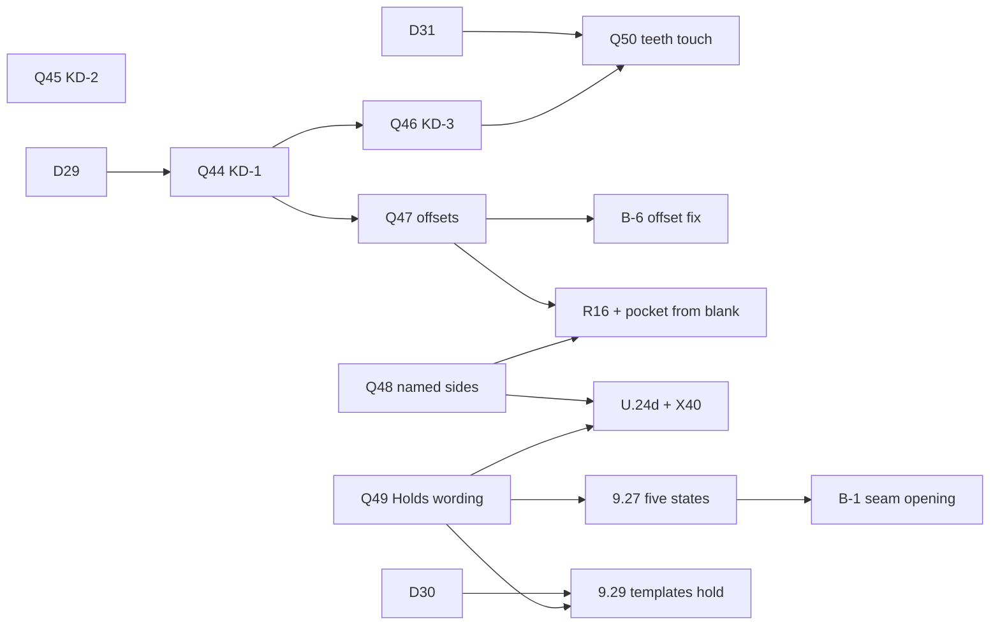

# Smart Features — the backlog from the audit

**Status: the 1.7 part approved by the maintainer on 2026-11-18,** with D29: Q44–Q49 are in the
roadmap's 1.7 Stage 3, their slices and the four amendments of §5 in the
[1.7 plan](2026-11-03-release-1.7.md#from-the-smart-features-audit-q45-q44-q46-q47-q48-q49), and X40
in the [UX register](../specs/2026-11-03-1.7-ux-audit.md). Everything else here is still a
proposal: the 1.8 tasks are recorded under the roadmap's *Later* as
[found by the audit](../../roadmap.md#found-by-the-smart-features-audit-2026-11-18), and D30–D35
are not decided.

This document turns the findings of [`smart-features.md`](../../smart-features.md) (PR #279,
develop 86c1e76) into tasks, after checking each against the code, the 1.7 plan, its specs and the
open issues.

**In one paragraph.** Six small slices join 1.7: the three confirmed defects (KD-1–KD-3), the two
controls a maker needs to finish a first pocket without an error (hole offsets, named sides), and
one that keeps 9.14b from saying more than it measured. Four planned items absorb the rest of what
1.7 needs (9.16, U.24d, R16, R18). Five tasks are suggested for 1.8. Seam-aware openings, named
opening edges, tooth-based clearance and every tolerance wait for evidence in the backlog. None of
the 1.7 additions changes a file format or anything printed, so none needs a paper check, and none
is on the critical path (9.13).

---

## 1. How the findings were checked

Each audit finding was traced to the code at develop 86c1e76 and matched against the 1.7 plan
(§4, §5), the roadmap, the UX audit register (X1–X39) and the GitHub issues. **No open issue concerns
Smart Features**: the three open ones are a Windows nightly from before #279 (#280), a scanner
skip (#274) and a macOS question (#97).

| Finding | Confirmed in the code | Where it goes |
|---|---|---|
| **KD-1** hole on the edge, verdict by orientation | `isOnMaterial` asks `PathOps.containsPoint`, with no answer on a boundary (`domain/src/material.ts:40`); holes do not get the storage-quantum allowance lines already get (`validate.ts:564`) | **New: Q44**, 1.7 |
| **KD-2** mirrored hardware hole never checked | `punchesOf` reads a hardware hole only when `source.kind === 'shape'` (`validate.ts:592–597`) | **New: Q45**, 1.7 |
| **KD-3** tooth through the edge not reported | `punchesOf` uses `holes.radiusMm ?? 0`; the tooth on the resolved holes (`stitch.ts:101`) is never read by a rule | **New: Q46**, 1.7 |
| Hole offsets unexposed (journey 2) | `startOffsetMm`/`endOffsetMm` are in the model, the schema since 1.6.0 and the commands (`commands.ts:1180`), and in no renderer file | **New: Q47**, 1.7 |
| Corners guessed in *Stitched sides* (journey 2) | `StitchLineEditor` offers *Corner 1…n*; the board numbers no corner | **New: Q48**, 1.7 |
| L1's overclaim, L3's hidden requirement, "no ease" silent | The editor shows *Holds* only while `resolved.ok` (`PropertyPanel.tsx:269`); the depth line names no piece | **New: Q49**, 1.7 |
| W4 / SF-H6: problem key ignores the requirement | `problemKey` is code, subject and qualifier (`problems/problem.ts:449`) | **Amend 9.16** (planned, ☐) |
| Corner radius fields named by arrows | `label="↖"` etc. in `shapeEditors/RectEditor.tsx:77–107`; not in the X register | **Amend U.24d** as X40 |
| A first pocket from blank, end to end | R16's workflows start from templates or copy | **Amend R16** |
| L1, L2, D21's slits: what a maker must know | No *known limitations* entry yet | **Amend R18** |
| W5: a pass is silence; the five states | No check record in the domain | **New: 9.27**, 1.8 |
| D24: holes show the reading, not the requirement | As decided in 9.14b ("a later refinement") | **New: 9.28**, 1.8 |
| SF-I2: no template states a purpose | Confirmed by the scenario | **New: 9.29**, 1.8, after D30 |
| Journey 5: no marking → stitching | No such command | **New: 9.30**, 1.8 |
| L2: typed teeth overlapping | No rule | **New: Q50**, 1.8, after D31 |
| W1 / L1 second step, D21's named opening | Model reads the stitching's own piece | **Backlog** (B-1, B-2) |
| SF-H4, hidden features, no-op undo step, an end-hole fix | See §7 | **Backlog** |
| `SEAM_RUNS_OFF_THE_LINE` negative and transition | The suite's two todos | **Test-only, outside the release gate** (T-1) |
| §5's sampler; drift and clearance limits | No measurement in the repository | **Research** (R-1, R-2) |

**Needs no task:**

- **W7**, domain tests filtering to their own codes: the suite now asserts whole lists, and §8's
  acceptance criteria require it of every Smart Features change.
- **`HOLE_COUNT_TOO_LOW`'s positive scenario**: `exempt` in `matrix.ts` with its reason (a rule
  about one feature's own geometry); the domain's tests hold it.
- **"Not verified physically"**: half of §5's fifth state already ships. `pocket.holds.note`
  says thickness and pull are not counted. Q49 and 9.27 keep it.
- **Semantic piece types**: rejected by the audit (§2), with reasons. §8 proposes a *Not planned*
  line so the question is not reopened without evidence.
- **Thickness, stretch, how many cards**: 9.1, already in *Later*.
- **Keyboard-only use of the journeys**: tracked by U.21's register and U.25.

## 2. Classification

**Kind** separates what is wrong from what is chosen: a **defect** is behaviour the code's own
contract says is wrong, reproduced and pinned; a **gap** is a missing control or statement observed
in a journey; a **limit** is the model reading correctly what it has; a **decision** waits on the
maintainer; **research** waits on leather.

**Priority:** P0, a wrong verdict a maker meets on a shipped construction, fixed before 1.7 ships.
P1, high impact on the core pocket workflow or on a 1.7 feature's honesty, in 1.7. P2, the next
release. P3, backlog: waits on a decision, evidence or demand.

| ID | Task | Category | Kind | P | Release | Size | Needs |
|---|---|---|---|---|---|---|---|
| **Q45** | A mirrored hardware hole is checked like its original | Confirmed defect | Defect (KD-2) | P0 | 1.7 | XS | — |
| **Q44** | A hole on the cut edge gets one verdict, whichever way the piece faces | Confirmed defect | Defect (KD-1) | P0 | 1.7 | S | D29 |
| **Q46** | A stitch tooth that cuts through the edge is off the leather | Confirmed defect | Defect (KD-3) | P1 | 1.7 | S | Q44 |
| **Q47** | End holes moved in from the edge, in Properties | UX/UI | Gap | P1 | 1.7 | S | Q44 |
| **Q48** | *Stitched sides* says which side is open | UX/UI | Gap | P1 | 1.7 | S | — |
| **Q49** | *Holds* says what it measured to, and stays while its line fails | Validation reliability | Limit (L1, L3) | P1 | 1.7 | S | — |
| 9.16 + | Accepting a warning remembers its cause | Validation reliability | Requirement on planned work | P1 | 1.7 | +XS | — |
| U.24d + | X40: corner radius fields named for a screen reader | UX/UI | Defect (a11y) | P1 | 1.7 | XS | — |
| R16 + | A card pocket from a blank rectangle, end to end | Test coverage | — | P1 | 1.7 | +XS | Q44, Q47, Q48 |
| R18 + | What the pocket check cannot see, in *known limitations* | Construction info, limits | — | P1 | 1.7 | +XS | — |
| **9.27** | A pocket check says what passed, and why | Validation reliability | Opportunity (W5) | P2 | 1.8 | M | Q49 |
| **9.28** | Selecting the holes shows their stitch line's requirement | UX/UI | Gap (D24) | P2 | 1.8 | S | — |
| **9.29** | Card templates say what their pockets hold | Construction info | Gap (SF-I2) | P2 | 1.8 | S | D30, Q49 |
| **9.30** | *Use as stitching* for a marking line | UX/UI | Gap (journey 5) | P2 | 1.8 | S | — |
| **Q50** | Teeth that run into each other are said to | Validation reliability | Limit (L2) | P2 | 1.8 | S | D31, Q46 |
| T-1 | `SEAM_RUNS_OFF_THE_LINE`'s missing scenarios | Test coverage | — | P2 | none | XS | — |
| B-1 | A declared seam gives a pocket its lower opening | Construction info, limits | Limit (L1) | P3 | backlog | M | 9.27, evidence |
| B-2 | A maker names a pocket's opening edge | Construction info, limits | Limit (L1, D21) | P3 | backlog | M | D35 |
| B-3 | A mirrored pocket's requirement follows its original | Validation reliability | Decision (SF-H4) | P3 | backlog | S | D33 |
| B-4 | Hidden features and the Print count | Validation reliability | Decision | P3 | backlog | XS | D34 |
| B-5 | A command that changes nothing is no undo step | Confirmed defect | Defect, latent | P3 | backlog | XS | — |
| B-6 | A fix that moves end holes in | UX/UI | Opportunity | P3 | backlog | S | Q47, demand |
| R-1 | The card-pocket sampler | Physical research | Research | P3 | backlog | Maker | — |
| R-2 | Seam drift and edge clearance, in more leathers | Physical research | Research | P3 | backlog | Maker | — |

Sizes are the 1.7 plan's: XS under a day, S a day or two, M a few days. IDs continue the roadmap's
free numbers (Q44+, 9.27+, X40, D29+); B-, T- and R- are this document's until one is promoted.

## 3. Decisions for the maintainer

D29 was approved on 2026-11-18 and is in the 1.7 plan's §3. The rest are taken when their task
is next.

| # | Decision | Recommended | Trade-off | Blocks |
|---|---|---|---|---|
| **D29** | The one verdict for a stitch hole on the cut edge | **On the leather**, by the precedent of Q2 (lines) and Q33 (rims): a hole within a storage quantum of an edge is on it, so it is `HOLE_TOO_CLOSE_TO_EDGE` at 0 mm, a warning. Once Q46 lands, a hole set that has a tooth is `OUTSIDE_PART` there, because its tooth crosses the edge | A hole with no iron stated (D26) and centred on the cut stays a warning. That holds the point contract of domain-model §8.6; the error comes from the tooth, which is a fact | Q44 |
| **D30** | The ease of a requirement that arrives with a template | **Copy the maker's *Pocket ease* into it when the template is opened or inserted**, as one is copied into a requirement made by hand. The template file carries none, and the project then holds its ease, so the same file shows the same problems on every bench | The audit proposed "the maker's, when not typed", read at evaluation. That makes a file's verdicts depend on a setting outside it. With D30, a maker whose ease is over 3.4 mm opens the bifold to a true warning (SF-I4), so the template stops opening clean for them | 9.29 |
| **D31** | `STITCH_HOLES_TOUCH` for typed teeth (L2) | **Yes, a warning**, by the same reading of the tooth's outline as Q46, parallel to `HOLES_OVERLAP` for a row | A new code with its matrix row. Only a typed tooth can trigger it (SF-K6) | Q50 |
| **D32** | Clearance measured from the tooth instead of the hole's centre | **Not yet.** Keep §8.6's point contract until R-2 says what 1.5 mm should mean for a tooth | Changing it moves verdicts on every toothed set at small insets; the figure was chosen for points | — |
| **D33** | A mirrored pocket's requirement: shared or copied (SF-H4) | **Shared**: the mirror reads its original's, as a mirrored hole set keeps its original's tooth (D28) | A maker who wants a different requirement on the mirror unlinks it first | B-3 |
| **D34** | Whether hidden features are checked and counted on Print | **Decide once, for every rule**, not for DR8. Hidden pieces are not printed (Q20) but their problems count on the Print button | — | B-4 |
| **D35** | A named opening edge (D21's limit) | **Wait** for a maker's slit pocket or B-1's result | — | B-2 |

## 4. Release 1.7: six new slices

Approved and moved: each slice's whole task — why, today, build, *Find out first*, *Done when*,
tests and pull request title — is in the
[1.7 plan's §5, Stage 3](2026-11-03-release-1.7.md#from-the-smart-features-audit-q45-q44-q46-q47-q48-q49),
where the `release-1-7` agent reads it. Order: Q45 → Q44 → Q46 → Q47 in lane D, Q48 and Q49 beside
them in Properties, both before U.24d.

**If 1.7 has to shrink**, Q49 moves out first, then Q48. The floor is Q44–Q47: three wrong verdicts,
and the control that clears the first error a pocket meets. Q46 stays because 9.26 ships in 1.7,
and a laser cut through the edge that nothing reports would ship with it.

## 5. Release 1.7: what planned slices take on

Written into the 1.7 plan: **9.16** stores the cause of an accepted warning, not only its key
(W4, SF-H6), with four scenarios and an `accepted` mark in the harness; **U.24d** closes X40, the
corner radius fields' names; **R16** gains a card pocket from a blank rectangle; **R18**'s known
limitations include the pocket check's (L1, L2, D21, thickness and pull).

## 6. Release 1.8, suggested

Recorded under the roadmap's *Later*; none is in a release until it is moved into one.

### 9.27 · A pocket check says what passed, and why

P2 · 1.8 · M · needs Q49 · validation reliability (W5).

**Problem.** A requirement that passes says nothing. The domain keeps no record of which checks
ran, passed, or could not run, so Properties cannot say "checked: 94 mm across, 87.6 mm needed"
without computing again.

**Outcome.** One domain function returns, per requirement, each check's state (§5's five) and both
numbers. DR8 is built on it, so the words and the verdict cannot disagree. Properties shows one line
per check.

**Acceptance.** §6's E2E "the five states": one U walked through nothing stated, met, not met and not
measurable, with no line on a closed stitch line or an outline. A property: the lines and DR8
never disagree. SF-B and SF-F scenarios unchanged.

**Links.** Audit W5, §5's five states, §8 item 7.

### 9.28 · Selecting the holes shows their stitch line's requirement

P2 · 1.8 · S · UX/UI (journey 4, D24's "later refinement").

**Problem.** The board shows holes most, and selecting them gives the reading but neither the
requirement nor its warning, which are on the stitch line.

**Outcome.** A hole set shows its stitch line's pocket problems and a button that selects the line
with *Holds* focused. It does not offer a second editor.

**Acceptance.** §6's E2E "requirement shown from the holes": a click on a hole on the board, then
the warning, the button, the line selected and *Holds* focused, axe clean.

**Links.** Audit §3 journey 4, §8 item 8; plan D24.

### 9.29 · Card templates say what their pockets hold

P2 · 1.8 · S · needs D30 and Q49 · missing construction information (SF-I2).

**Problem.** No template states a purpose, so DR8 is off on all of them, and a maker may believe
the card pockets were checked.

**Outcome.** The card holder and bifold ship with *Holds: Payment card*, not held fully, and the
maker's ease arrives as D30 decides.

**Acceptance.** SF-I2 inverted. With no ease set, the templates open clean and say "no ease"
(Q49). With 4 mm in My tools, the bifold warns and the card holder does not (SF-I4). Template
format and the corpus unchanged.

**Links.** Audit §3 journey 3, §7, §8 item 10; plan D20.

### 9.30 · *Use as stitching* for a marking line

P2 · 1.8 · S · UX/UI (journey 5).

**Problem.** An imported SVG without layer names brings open paths in as markings. No command
turns a marking into stitching, so seams and pocket checks need the line redrawn.

**Outcome.** *Use as stitching* on a marking line, and back, as one undo step. It is refused by
name where a reference would break. The import preview says a layer named `stitch` does this on the
way in.

**Find out first.** What may reference a marking line and a stitch line (dimensions, derived hole
sets), and whether going back with holes on the line refuses or freezes them (8.8b-4's semantics).

**Acceptance.** §6's E2E "use as stitching", from `e2e/svgPatterns.ts`'s unlayered U. A scenario:
converted, then holes, then a requirement; undo walks back exactly.

**Links.** Audit §3 journey 5, §8 item 11; 9.20b.

### Q50 · Teeth that run into each other are said to

P2 · 1.8 · S · needs D31 and Q46 · validation reliability (L2).

**Problem.** A 4 mm prong at a 3.9 mm spacing cuts one slot, and nothing says so, as
`HOLES_OVERLAP` does for a row. Only a typed tooth can do it.

**Outcome.** As D31 decides, a warning naming the holes, from the same tooth outline Q46 reads.

**Acceptance.** A new matrix row with all four classes (or `exempt` with a reason). SF-K6 still
silent. 9.15's explanation.

**Links.** Audit §7 L2.

## 7. Backlog: decisions, research and small items

**B-1 · A declared seam gives a pocket its lower opening** (P3, M). DR8 reads a front sewn to the
panel for the real opening (SF-E7 then reports *too shallow*; SF-E6 unchanged). It is multi-piece
semantics, so it waits until 9.27 shows what makers read and one asks for it. Q49 already stops it
from misleading anyone.

**B-2 · A maker names a pocket's opening edge** (P3, M, D35). For slit pockets and SF-E4's
construction, a maker names the edge, as a fold mirror names its fold. Wait for a real pattern.

**B-3 · A mirrored pocket's requirement follows its original** (P3, S, D33). SF-H4 changes on
purpose.

**B-4 · Hidden features and the Print count** (P3, XS, D34). One rule for every check.

**B-5 · A command that changes nothing is no undo step** (P3, XS, latent defect).
`setFeatureField` returns a new document whatever it did, and the store records any new document
(`document/src/store.ts:112` guards identity only). The fields commit only on change
(`NumberField.tsx:138`), so no UI path was found that reaches it. The fix is once, in
`setFeatureField`, with a property that a no-op command leaves history unchanged. It rides with the
next change to `commands.ts` that touches it.

**B-6 · A fix that moves end holes in** (P3, S). 9.17's third kind: set the offsets that clear the
edge, previewed, one step. Build it only if makers miss it after Q47.

**T-1 · `SEAM_RUNS_OFF_THE_LINE`'s negative and transition** (P2, XS, test-only). The suite's two
todos: a side that follows the other's length and fits its line says nothing, and lengthening the
line until it fits clears the error. It changes no product code, so it lands as a `test:` pull
request with no roadmap line, as #279 did.

**R-1 · The card-pocket sampler** (P3, maker). §5's plan: pockets 86 to 92 mm between stitch lines in
1 mm steps; two leather pairings (about 1.0 + 1.0 and 1.4 + 1.4 mm); 1, 3 and 6 cards; each one
recorded as goes in freely, firmly, or not at all, in `print-verification-log.md`. It gates any
suggested ease or tolerance. Nothing in 1.7 or 1.8 waits on it.

**R-2 · Seam drift and edge clearance, in more leathers** (P3, maker). The 0.5 mm drift (D4) was
checked on one card holder. The 1.5 mm clearance is an expert figure, measured from a point. More
constructions, and thin firm against soft thick leather, would inform D32 and 9.1.

## 8. Where it went

| What | Where |
|---|---|
| Q44–Q49 | Roadmap 1.7 Stage 3; plan §0, §4 (table D), §5 Stage 3, §6 |
| D29 | Plan §3 |
| 9.16, U.24d, R16, R18 amendments | Their slices in plan §5 |
| X40 | UX register, U.24d |
| 9.27–9.30, Q50 | Roadmap *Later*, *Found by the Smart Features audit* |
| D30–D35, B-1–B-6, T-1, R-1, R-2 | Here only, until decided or promoted |

**Still proposed, under *Not planned*:**

```markdown
- **Piece types** (*Wallet*, *Pocket*, *Strap*). No rule needs one: a purpose belongs on a
  relationship — this stitching holds a card, these holes are sewn — and guessing it from shape
  turns a keeper loop into a false warning ([smart-features](smart-features.md) §2).
```


