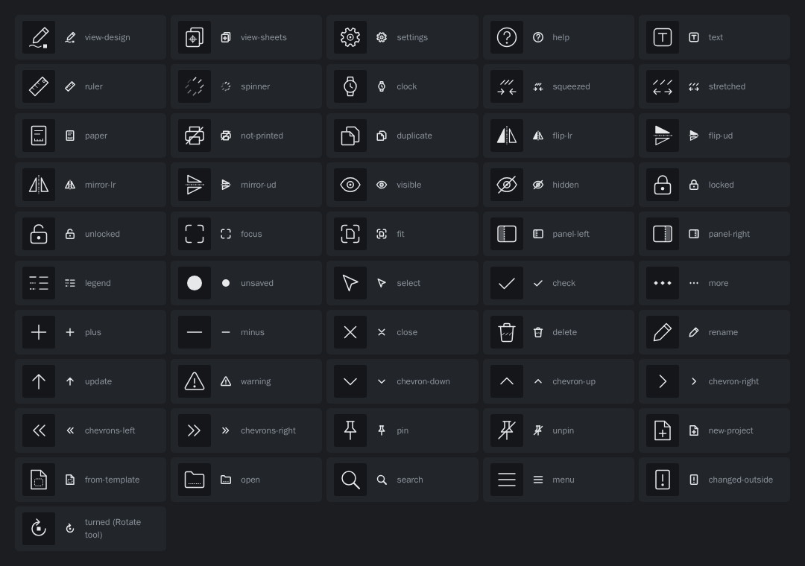

# The icon set — an audit

**Date:** 2026-10-25 · **Decision:** [ADR 0021](../../adr/0021-leathercad-draws-its-own-icons.md) ·
**Code:** `apps/desktop/src/renderer/src/icons/Icon.tsx`

LeatherCAD draws every icon in its interface. This is the record of how each one was judged: the
job it has, whether words sit beside it, what the established sets draw for that job, and how the
first round's drawing read at its real size. Round 2 redrew the 11 that failed or were at
risk; the rest passed as drawn.

## The rule

**The outline says what it is. The detail says whose it is.**

1. **Job.** What the icon must say, in a line.
2. **Words.** *Beside*: a label always sits next to it. *Alone*: the icon is the whole control,
   with a tooltip on hover — so it must be the shape people already look for.
3. **Others draw.** What Material Symbols and Lucide draw for the same job: the outline people
   have learned. Names are those sets' own, read from their published lists.
4. **Read at size.** Drawn at its real 8–16 px: **Pass**, it says its job; **Risk**, it could be
   taken for something else; **Fail**, it says something else.

The LeatherCAD detail sits inside the conventional outline: a rivet for a point, slits at the
pricking iron's slant, one 45° strike for every “off”, a stitched seam, a pattern card's clipped
corner, a steel rule's hanging hole, the fold's dash-dot for an axis. A dashed line still means a
stitch line. The outline itself is leather only where the thing is: the spacing glyphs and the
legend's key.

## Redrawn in round 2

| Icon | Drawn as | Job | Words | Others draw | Round 1 read | LeatherCAD detail |
|---|---|---|---|---|---|---|
| Design view | `view-design` | Go to where pieces are drawn. | beside | A pencil and the line it drew — Material `draw`, `design_services`; Lucide `pen-tool`, `pencil-ruler`. | **Fail** — The round knife is leatherwork’s emblem, but people outside the craft see an anchor, and nothing in it says drawing. (A pencil crossed with a rule, tried next, makes an X at 16 px — it reads as Close.) | The line ends in a construction node, as every drawing tool’s icon does. |
| Settings | `settings` | Open Settings. | alone | A gear — Material `settings`, Lucide `settings`. Among the few icons people find without a label. | **Fail** — Thin spikes on a ring read as a sun or a virus. Alone in the corner, Settings must be the shape people already hunt for. | Its hub is a rivet: a ring and its post. |
| Help | `help` | Open Help. | alone | A question mark in a circle — Material `help`, Lucide `circle-question-mark`. | **Risk** — The question mark carried it, but a tag outline says “price” or “label” first, and it sits next to Settings with no words. | The question mark’s point is a diamond hole, as in More. |
| Paper | `paper` | Choose the paper. | beside | A page — Lucide `file`, Material `description` (a page with lines of print). | **Risk** — A rounded rectangle with a bar near its foot looked like a phone with its home button. | Under the lines of print, the 100 mm gauge every sheet carries. |
| Not printed | `not-printed` | Say this piece will not print. | alone | A printer, struck or crossed — Material `print_disabled`, Lucide `printer-x`. | **Fail** — A struck sheet says “no page” or “cancelled”. What is withheld is printing, and printing is a printer. | Struck at the iron’s 45°, as every “off” is. |
| Mirror ↔ | `mirror-lr` | Make a linked counterpart to the right, across a vertical line. | beside | A shape and its reflection across a dashed axis — Lucide `square-centerline-dashed-horizontal`, Material `flip`. | **Risk** — Round 1 drew two triangles meeting at a horizontal line: an hourglass, the sign for waiting — and across the wrong axis, since this mirror puts the counterpart to the right. | Drawn as Flip is, with both sides present: Flip shows a piece and where it goes, Mirror shows two pieces. |
| Mirror ↕ | `mirror-ud` | Make a linked counterpart below, across a horizontal line. | beside | A shape and its reflection across a dashed axis — Lucide `square-centerline-dashed-vertical`, Material `flip`. | **Risk** — Round 1 drew two triangles pointing at a vertical line: Lucide’s own `fold-horizontal`, squeeze toward the middle — and across the wrong axis, since this mirror puts the counterpart below. | As Mirror ↔, turned. |
| Focus | `focus` | Hide the panels; the board fills the window. | beside | Four corners pushed out — Lucide `maximize`, Material `fullscreen`. | **Risk** — Corners around a dot is the camera’s focus — Lucide’s `focus` and Material’s `center_focus_strong` are exactly that. Here nothing is being aimed at; the window is being cleared. | None needed: the corners are the set’s rounded ones. |
| Pin | `pin` | Keep a project at the top of the list. | alone | A push pin — Lucide `pin`, Material `push_pin`. | **Fail** — A diagonal awl read as a key, a needle or a spoon. Pinning is a push pin to everyone. | None — a plain push pin. |
| Unpin | `unpin` | Let a project go back to its place. | alone | The push pin, struck — Lucide `pin-off`, Material `keep_off`. | **Fail** — A lifted awl over a gap is too subtle a difference to toggle on. | Struck at the iron’s 45°. |
| New from a template | `from-template` | Start from a worked project. | beside | A page with something laid out on it — Lucide `layout-template`. | **Risk** — The pocket’s thumb scoop turned the card into an envelope. | A stitch line already drawn on the card. |

## The window’s big switches

Seen first and used most: the two views, Settings and Help.

| Icon | Drawn as | Job | Words | Others draw | Round 1 read | LeatherCAD detail |
|---|---|---|---|---|---|---|
| Sheets view | `view-sheets` | Go to the printed pages. | beside | Stacked pages — Lucide `files`, Material `file_copy`. | Pass | The registration cross the app prints to line sheets up. |

## Workshop tools

Where the job is something a maker does at the bench.

| Icon | Drawn as | Job | Words | Others draw | Round 1 read | LeatherCAD detail |
|---|---|---|---|---|---|---|
| Text tool, text label | `text` | Put words on a piece. | beside | A capital T — Lucide `type`, Material `title`. | Pass | The square is a letter stamp’s face. |
| Measure the gauge | `ruler` | Measure the printed gauge. | beside | A ruler on the diagonal — Lucide `ruler`, Material `straighten`. | Pass | The hanging hole a steel rule has. |
| Working… | `spinner` | Say something is in progress. | beside | A ring of fading marks, turning — Lucide `loader`, Material `progress_activity`. | Pass | The marks are stitch slits at the iron’s 45°. |
| Wait | `clock` | Say when to try again. | beside | A clock face — Lucide `clock`, `watch`; Material `schedule`. | Pass | A watch on its strap — one of the first things a maker sews. |
| Holes closer than the pitch | `squeezed` | Say the iron had to squeeze the holes. | beside | Arrows pointing in — Material `format_letter_spacing`, Lucide `fold-horizontal`. | Pass | The marks are three iron slits at 45°. |
| Holes further apart than the pitch | `stretched` | Say the iron had to stretch the holes. | beside | Arrows pointing out — Material `format_letter_spacing_wide`, Lucide `unfold-horizontal`. | Pass | The same slits. |

## Paper and pieces

Pattern cards, printed sheets, and moving a piece about.

| Icon | Drawn as | Job | Words | Others draw | Round 1 read | LeatherCAD detail |
|---|---|---|---|---|---|---|
| Duplicate | `duplicate` | Make a copy of the piece. | beside | Two overlapping pages — Lucide `copy`, Material `content_copy`. | Pass | The pages are pattern cards, clipped at the corner like the piece mark. |
| Turned to fit | the Rotate tool’s icon | Say the sheets turned this piece. | alone | A turning arrow — Lucide `rotate-cw`, Material `rotate_90_degrees_cw`. | Pass | The Rotate tool’s own drawing, pivot node and all. |
| Flip ↔ | `flip-lr` | Turn the piece over, left to right. | beside | Two triangles across a dashed axis — Lucide `flip-horizontal`, Material `flip`. | Pass | The axis in the fold’s dash-dot rhythm. |
| Flip ↕ | `flip-ud` | Turn the piece over, top to bottom. | beside | The same, turned. | Pass | As above. |

## Seeing and holding

Toggles and states, mostly alone in a row: the strictest place for convention.

| Icon | Drawn as | Job | Words | Others draw | Round 1 read | LeatherCAD detail |
|---|---|---|---|---|---|---|
| Shown | `visible` | Hide or show a line. | alone | An eye — Lucide `eye`, Material `visibility`. | Pass | Its pupil is a rivet. |
| Hidden | `hidden` | Say a line is hidden. | alone | The eye, struck — Lucide `eye-off`, Material `visibility_off`. | Pass | Struck at the iron’s 45°. |
| Locked | `locked` | Say a line cannot be changed. | alone | A closed padlock — Lucide `lock`, Material `lock`. | Pass | Its keyhole is a rivet. |
| Unlocked | `unlocked` | Say a line can be changed. | alone | The padlock, open — Lucide `lock-open`, Material `lock_open_right`. | Pass | As above. |
| Fit | `fit` | Zoom so every piece is in view. | beside | Corners around a shape — Lucide `fullscreen`, Material `fit_screen`. | Pass | The shape inside is a pattern card. |
| Parts panel | `panel-left` | Show or hide the Parts panel. | beside | A window with its left column — Lucide `panel-left`, Material `left_panel_open`. | Pass | Its seam is stitched. |
| Properties panel | `panel-right` | Show or hide the Properties panel. | beside | A window with its right column — Lucide `panel-right`. | Pass | As above. |
| Legend | `legend` | Unfold the key to the line types. | beside | A list — Lucide `list`, Material `legend_toggle`. | Pass | The samples are the board’s own: solid, stitched, folded. |
| Unsaved changes | `unsaved` | Say there are unsaved changes. | beside | A dot — the unsaved dot of most editors. | Pass | — |

## The plain glyphs

Read without being looked at. Redrawn on the set’s grid, never decorated.

| Icon | Drawn as | Job | Words | Others draw | Round 1 read | LeatherCAD detail |
|---|---|---|---|---|---|---|
| Select | `select` | Pick things. | beside | The pointer — Lucide `mouse-pointer-2`. | Pass | — |
| Done, matches | `check` | Say all is well. | beside | A tick. | Pass | Its long stroke runs at the iron’s 45°. |
| More | `more` | Open more actions. | alone | Three dots — Lucide `ellipsis`, Material `more_horiz`. | Pass | The dots are diamond holes, as a diamond iron leaves them. |
| Add | `plus` | Add, or zoom in. | alone | Plus. | Pass | — |
| Zoom out | `minus` | Zoom out. | alone | Minus. | Pass | — |
| Close | `close` | Close. | alone | An X. | Pass | — |
| Delete | `delete` | Delete. | beside | A bin — Lucide `trash-2`, Material `delete`. | Pass | Its ribs are slits at the iron’s 45°: the offcut bin. |
| Rename | `rename` | Rename. | beside | A pencil — Lucide `pencil`, Material `edit`. | Pass | — |
| Update available | `update` | Say a newer version exists. | beside | An arrow up. | Pass | — |
| Warning | `warning` | Warn. | beside | A triangle with “!”. | Pass | — |
| Open a menu, fold down | `chevron-down` | Unfold downward. | alone | Chevron. | Pass | — |
| Fold up | `chevron-up` | Fold upward. | alone | Chevron. | Pass | — |
| Unfold a tree row | `chevron-right` | Unfold a row. | alone | Chevron. | Pass | — |
| Collapse the rail | `chevrons-left` | Narrow the rail. | alone | Double chevron. | Pass | — |
| Expand the rail | `chevrons-right` | Widen the rail. | alone | Double chevron. | Pass | — |

## On the multi-window branch

Only on feat/multi-window, not in develop yet. Drawn now so the set is whole; swapped in by whichever branch merges second.

| Icon | Drawn as | Job | Words | Others draw | Round 1 read | LeatherCAD detail |
|---|---|---|---|---|---|---|
| New project | `new-project` | Start a blank project. | beside | A page with a plus — Lucide `file-plus`, Material `note_add`. | Pass | The page is a pattern card. |
| Open | `open` | Open a project from disk. | beside | A folder — Lucide `folder-open`, Material `folder_open`. | Pass | Stitched along its foot. |
| Search | `search` | Search. | alone | A magnifier. | Pass | — |
| Project menu | `menu` | Open the project menu. | alone | Three lines. | Pass | — |
| Changed on disk | `changed-outside` | Say the file changed elsewhere. | beside | A page with “!” — Lucide `file-warning`. | Pass | — |

## Not drawn in code

The start screen's *Open sample project* has no icon today. A bifold wallet — outline, stitch line,
fold — was drawn for it in the review and left out until someone asks for one.
